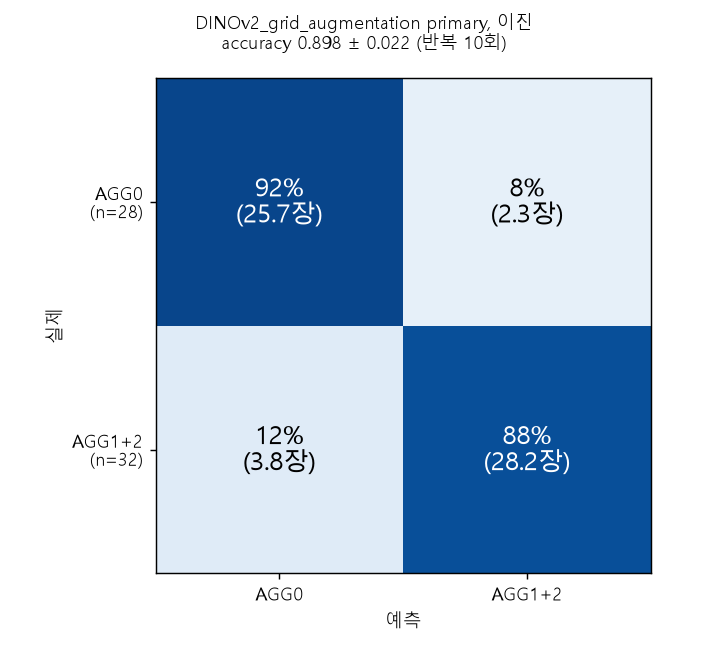

# DINOv2_binary: 이진 라벨(AGG0 vs AGG1+AGG2)로 평가한 DINOv2_grid_augmentation

`DINOv2_grid_augmentation` 이 만든 타일 특징(고정 DINOv2 ViT-B/14, 원본 + 배경 증강 5개)을 그대로 쓰되, 라벨만 이진으로 바꿔 같은 16개 설정을 학습하고 평가한다. 새 특징 추출은 하지 않는다.
라벨: AGG0 = 0 (28장), AGG1 + AGG2 = 1 (32장).

## 평가

| 평가 | 분할 |
|---|---|
| IMG | 이미지 단위 층화 5-fold x 10 반복 (`DINOv2_grid_augmentation` 의 e00 분할을 그대로 사용, 3분류 라벨로 층화된 분할) |
| LOCO | 처리 조건 1개를 통째로 제외 (10 fold) |
| LOMO | 처리 방법 1개를 통째로 제외 (5 fold) |

- 학습은 `DINOv2_grid_augmentation` 과 같다: 이미지 단위 설정(합치기, whole_image)은 학습 이미지의 모든 버전(원본 + 증강 5개)을 학습 행으로, SL(타일 단위)은 학습 타일마다 6개 버전 중 하나를 무작위로 쓰고, 평가는 항상 원본으로 한다.
- 분류기는 3분류 실험과 같다 (logreg: 표준화 + L2, C=1, class_weight balanced / kNN: k=5, cosine, 거리 가중). 라벨만 이진이다.
- 지표는 fold 를 합친 60장 예측으로 계산한다. IMG 는 반복마다 구해 평균 ± SD, LOCO/LOMO 는 한 번. AUROC 는 양성 확률의 순위 지표다 (LOCO/LOMO 는 fold 마다 모델이 달라 참고용).
- 설정은 결과를 보기 전에 고정했다. primary = 특징 cls, 합치기 mean, 분류기 logreg.

## 결과 (primary: cls, mean, logreg)

| 평가 | accuracy | 이미지 단위 95% CI | AUROC | recall AGG0 / AGG1+2 |
|---|---|---|---|---|
| IMG | 0.898 ± 0.022 | [0.835, 0.952] | 0.968 | 0.92 / 0.88 |
| LOCO | 0.850 | [0.750, 0.933] | 0.954 | 0.82 / 0.88 |
| LOMO | 0.833 | [0.733, 0.917] | 0.944 | 0.79 / 0.88 |

라벨만 쓰는 단순 규칙(모델 없음)과 비교:

| 규칙 | IMG | LOCO | LOMO |
|---|---|---|---|
| 학습 fold 다수 클래스 | 0.533 | 0.100 | 0.167 |
| 같은 처리 조건의 다른 5장 다수 라벨 (처리 조건 암기) | **0.933** | - | - |
| 같은 온도 다수 라벨 | - | 0.667 | 0.667 |

- 처리 조건을 외우는 규칙(0.933)이 primary(0.898)보다 높다. 처리 조건과 라벨이 얽혀 있다는 문제는 이 실험으로 해소되지 않았다.
- 이미지 60장, 처리 조건 10개의 작은 데이터라 신뢰구간이 넓다. 위 점수는 탐색적 관찰이다.
- 3분류 accuracy 와 직접 비교할 수 없다 (이진의 다수 클래스 기준선은 0.533, 3분류는 0.467).

## 혼동행렬 (primary, IMG)

이미지 단위 5-fold x 10 반복의 반복 평균 (칸 안은 이미지 수와 그 행(실제 클래스) 안의 비율, `b13_confusion_figure.py` 가 그림으로 그린다). accuracy 0.898 ± 0.022.

| 실제 \ 예측 | AGG0 | AGG1+2 |
|---|---|---|
| AGG0 (28장) | 25.7 (92%) | 2.3 (8%) |
| AGG1+2 (32장) | 3.8 (12%) | 28.2 (88%) |

관찰: 두 방향 오류가 비슷하고, AGG1+2 를 AGG0 으로 놓치는 비율(12%)이 AGG0 을 AGG1+2 로 잘못 보는 비율(8%)보다 조금 높다.

## 스크립트 (실행 순서)

| 스크립트 | 내용 |
|---|---|
| `b10_run_binary_cv.py` | 16개 설정을 IMG, LOCO, LOMO 로 학습하고 평가, 예측 저장 |
| `b11_baselines_permutation.py` | 라벨만 쓰는 기준선, 라벨 순열 검사 |
| `b12_report.py` | 표, 부트스트랩 CI, 쌍 차이, 보고서 |
| `b13_confusion_figure.py` | primary 의 혼동행렬 그림 (IMG, 반복 평균) |
| `bcommon.py`, `config.yaml` | 공용 함수와 설정 |

환경: Python, numpy, scikit-learn, PyYAML, matplotlib. GPU 는 필요 없다.

## 입력과 실행

이 폴더의 코드는 다른 폴더의 코드를 import 하지 않는다 (공용 함수는 `bcommon.py` 안에 있다). 다만 입력 파일 두 가지가 필요하고, 저장소에는 올라와 있지 않다(출력이라 올리지 않았다). `config.yaml` 의 경로는 후보 목록이라 아래 위치를 차례로 찾는다.

| 입력 | 저장소 구조에서의 위치 | 만드는 법 |
|---|---|---|
| 이미지 조건표와 분할 (`conditions.csv`, `splits.csv`) | `../DINOv2/outputs/e00_make_splits/` | `model/DL/DINOv2` 의 `e00_make_splits.py` |
| 타일 특징 (`features.npz`, `tile_index.csv`) | `../DINOv2_grid_augmentation/outputs/e01_extract_features/` | `model/DL/DINOv2_grid_augmentation` 의 파이프라인 (`g00` → `e00` → `e01`) |

실행 순서는 `b10` → `b11` → `b12` (→ `b13`) 이고, 각 스크립트는 이 폴더에서 `python b10_run_binary_cv.py` 처럼 실행한다. 출력은 이 폴더의 `outputs/` 에 쓰이며 올리지 않았다.

## 참고

- 출력(예측, 표, 보고서)과 위 혼동행렬 그림(`figures/`) 외의 그림은 올리지 않았다.
