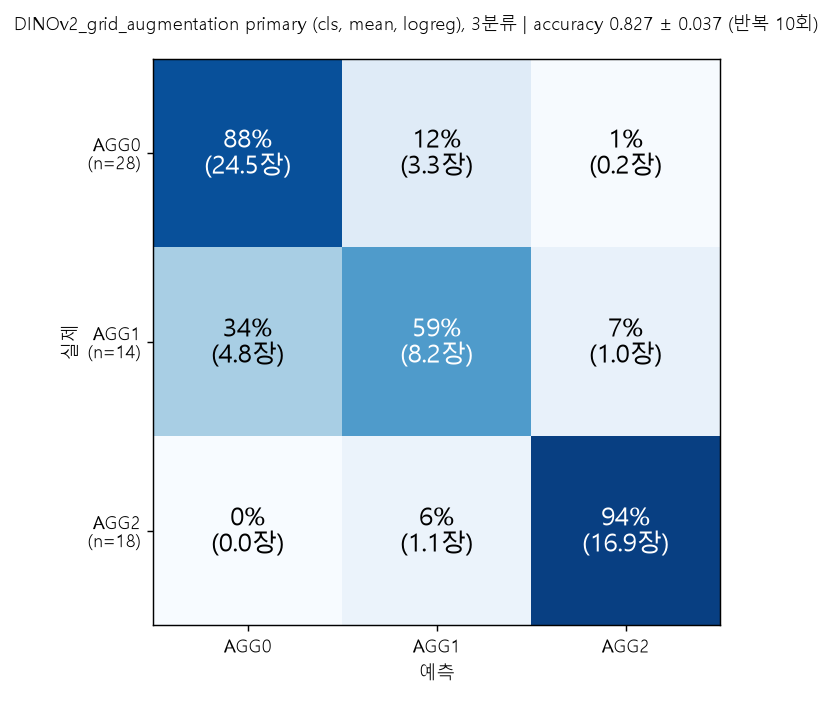

# 모델·실험, 배경 증강 판 (고정 DINOv2 특징 → 이미지 단위 합치기 → 분류기, 학습에 배경 증강 사용)

`model/DL/DINOv2_grid` 와 **학습 및 평가 방식이 전부 같고, 학습에 배경 증강본을 함께 쓴다**는 점만 다른 실험이다. 10x 이미지 60장(AGG0 28 / AGG1 14 / AGG2 18)에서 고정 DINOv2 ViT-B/14 특징을 뽑고, 이미지 단위로 합쳐 AGG0/1/2 를 분류한다.
증강은 **시편 픽셀을 바꾸지 않고 시편 마스크 밖(배경) 픽셀만** 무작위로 바꾼다. 평가는 항상 원본 이미지로만 한다.

- 범위: 특징 추출 → 합치기 → 분류기 → 이미지 단위 층화 반복 K-fold 평가. **모델은 학습하지 않았다** (DINOv2 고정, 분류기는 로지스틱 회귀/kNN). 증강은 분류기 학습 행을 늘리는 역할만 한다.
- 원본 이미지, `ML_preproc` 출력, 배경 증강 코드와 파라미터, 기존 실험의 분할과 결과는 읽기만 했다.
- 모든 실행은 단계 이름이 붙은 파이썬 스크립트이고, 파라미터는 `config.yaml` 한 곳에 있다.

## 1. 한눈에 보기

| 항목 | 값 |
|---|---|
| 입력 | 10x 이미지 60장, 분석 타일 2,591개 (`model/DL/DINOv2_grid` 와 같은 타일: 224px, 서로 겹치지 않음, 시편 픽셀 0인 타일 제외) |
| 증강 | 이미지당 배경 증강본 5개 (원본 포함 6개 버전). 시편(마스크 안쪽)과 마스크 경계 8px 이내는 원본 그대로, 그 바깥 16px 구간에서 합성 배경으로 섞는다 |
| 학습 | 이미지 단위 설정은 학습 이미지의 6개 버전을 모두 학습 행으로, SL(타일 단위)은 학습 타일마다 6개 버전 중 하나를 무작위로 |
| 평가 | 이미지 단위 층화 5-fold x 반복 10회 (seed 0), 원본 test 이미지로만 평가. 분할은 `model/DL/DINOv2_grid` 와 sha256 이 같다 |
| primary (결과를 보기 전에 고정, 이전과 같음) | 특징 cls / 합치기 mean / 분류기 logreg → **accuracy 0.827±0.037, macro-F1 0.802±0.045** (이미지 단위 95% CI [0.748, 0.898], 처리 조건 단위 [0.703, 0.938]) |
| 증강 없음 (DINOv2_grid) | primary 0.813±0.024 → **증강 효과 +0.013, 이미지 단위 95% CI [−0.027, +0.058] 이 0 을 포함** (단정하지 않음) |
| 기준선 | 다수 클래스 0.467, **처리 조건 암기 0.900** (primary 0.827 은 이를 넘지 못함, 아래 8절) |
| 순열 검사 | primary 20회 평균 accuracy 0.352, macro-F1 0.315 (최대 0.432), 다른 설정 3개도 모두 기준 통과 |
| 실행 환경 | WSL2 (Ubuntu) + RTX 3060, `model/DL/DINOv2` 와 같은 가상환경 |

전체 보고서는 `outputs/e04_report/report.md`, 증강 없음과의 비교는 `outputs/c01_compare_with_grid/compare_report.md`.

## 2. `model/DL/DINOv2_grid` 와 다른 점

| 파일 | `model/DL/DINOv2_grid` 와 비교 |
|---|---|
| `g00_make_tile_list.py`, `e00_make_splits.py`, `e02_reference_baselines.py`, `e06_extra_checks.py`, `run_wsl.sh`, `run_pipeline_wsl.sh`, `requirements_freeze_wsl.txt` | **같은 파일** |
| `e01_extract_features.py` | **다시 썼다**: 원본(k=0)과 배경 증강본(k=1..5)에서 타일 특징과 이미지 전체 특징을 뽑는다 (3절) |
| `common.py` | 증강 특징을 읽는 함수 4개 추가 (`load_aug_features`, `image_vectors`, `stack_versions`, `pick_versions_tiles`) |
| `e03_run_cv.py`, `e05_sanity_permutation.py`, `e07_permutation_other_settings.py`, `e11_train_final.py` | 특징을 버전별로 읽고, 학습에 모든 버전(SL 은 타일마다 무작위 한 버전)을 쓰고, 평가와 예측은 원본(k=0)으로 하도록 바꿨다. 분류기 정의, 지표, 순열 기준은 같다 |
| `e04_report.py` | 보고서 제목과 입력 설명 문장에 증강 사용을 적은 것뿐 (바뀐 줄 2줄) |
| `config.yaml` | 경로(`bgaug_config`, `bgaug_aug_params`, `exp_dir`, `exp_grid_dir`)와 `aug` 항목 추가 |
| `c01_compare_with_grid.py` | **새로 추가**: 증강 판과 증강 없음(`model/DL/DINOv2_grid`)을 설정별로 쌍으로 비교하고, primary 를 기준선과도 쌍으로 비교한다 |

## 3. 증강 방식

- 증강 함수와 파라미터는 `data/preproc_2` 의 `bg_common.augment_image`, `config.yaml` 의 `bgaug` 항목, b01 이 60장 배경에서 측정한 풀(`aug_params.json`)을 **읽기 전용으로 그대로** 쓴다 (같은 이미지 번호, 같은 시드 → 배경 증강 실험과 같은 증강본).
- 이미지 전체에 한 번 적용한 뒤 타일을 자른다. 시편(마스크 안쪽)과 마스크 경계 8px 이내는 바꾸지 않고(코드로 확인), 그 바깥 16px 구간에서 알파 블렌딩으로 합성 배경에 섞는다. 스케일바 구역도 마스크 밖이면 합성 배경으로 바뀐다.
- 합성 배경 = 평균색 + 저주파 색 장 + 중간 대역 질감 + 채널 상관을 맞춘 미세 노이즈. 값은 60장 배경 측정 풀에서 라벨 없이 무작위로 한 이미지 것을 뽑는다.
- 증강본은 이미지당 5개로 고정이다 (k=1..5, 시드 = (seed, 이미지 번호, k)). 학습 때마다 새로 뽑는 방식이 아니라, 분류기가 반복 학습을 하지 않으므로 고정된 증강본 5개를 학습 행으로 쓴다.
- 증강본에서 자른 타일이 원본 타일과 픽셀이 같으면(배경이 없거나 배경이 모두 마스크 경계 8px 안) 다시 계산하지 않고 원본 특징을 가리킨다. 이번 실행에서 증강본 타일 12,955개 중 5,930개(45.8%)가 원본과 달랐다.
- 이미지 전체(whole_image) 특징은 버전마다 마스크 bbox 를 잘라 224x224 로 resize 한 한 장의 cls 이다.

## 4. 용어

- 1단계 폴더(BASE, BASE-LC, BASE-LCSI, BASE-LSi, REF, REF-LN) = **금속 종류** (6종)
- 2단계 폴더(NPH1035, PH1180-1050 ...) = **처리 조건** = 처리 방법(NPH, PH1180, PH1205, PH1230, PH1255, 5종) x 온도(1035, 1050, 2종) = 10종
- 이미지 10x 는 (금속 종류 x 처리 조건)마다 1장, 모두 60장.
- `config.yaml` 의 `forbidden_terms` 에 있는 말은 스크립트, 로그, 보고서에서 쓰지 않는다 (e04, e05 가 검사).

## 5. 실행 환경과 방법

환경은 `model/DL/DINOv2` 와 같다 (WSL 가상환경 `~/agg_exp_venv`, torch + CUDA, scikit-learn). 증강 함수가 opencv 를 쓰므로 `data/preproc_2` 의 `setup_env_wsl_bgaug.sh` 로 `opencv-python-headless` 를 추가해야 한다. 이 PC 는 Windows 애플리케이션 제어 정책이 torch 를 막아 WSL 에서만 돌린다.

선행 조건 (읽기 전용 입력, `config.yaml` 의 상대경로는 이 폴더를 로컬의 다른 폴더들과 같은 위치에 두었을 때의 값이라 이 저장소 배치에 맞춰 고쳐야 한다):
- `data/preproc_2`: 증강 함수 `bg_common.py` 와 `config.yaml`, b01 이 만든 `aug_params.json` (`bgaug_config`, `bgaug_aug_params`)
- `data/ML_preproc` 출력: 시편 마스크, `tiles.csv` (`g00` 이 읽음, sha256 앞 12자리 `c645ee4f9630`)
- `data/preproc` 출력: `s00b_meta_mag/manifest_v1.csv`, 10x 원본 이미지
- `model/DL/DINOv2`(`exp_dir`: 모델 출처 해시, 기준선 예측), `model/DL/DINOv2_grid`(`exp_grid_dir`: 증강 없는 결과와 비교, 원본 특징 일치 확인)
- DINOv2 공식 저장소와 가중치 (`~/.cache/torch/hub`)

```
# Windows (전처리용 가상환경의 python, numpy + cv2 + PyYAML 만 필요)
python g00_make_tile_list.py

# WSL (이 폴더에서): e00 ~ e11 을 순서대로 실행하고 한 단계라도 실패하면 멈춘다
bash run_pipeline_wsl.sh

# Windows: 증강 없음(DINOv2_grid) 과의 비교, 기준선과의 쌍 차이 (numpy + matplotlib 만 필요)
python c01_compare_with_grid.py
```

소요 (이번 실행): e01 약 3.5분, e03 약 31분 (SL 의 타일 단위 logreg 가 대부분), e07 약 49분, 나머지는 각 몇 초.

## 6. 폴더 구조

```
DINOv2_grid_augmentation/
├── config.yaml                  # 모든 파라미터 (하드코딩 금지)
├── common.py                    # config, 로그, 입력 로딩, 조건 파싱, 지표, 부트스트랩, 금지어 검사, 증강 특징 로딩
├── g00_make_tile_list.py        # 격자 2,880개(stride 224) -> 분석 타일 2,591개 (DINOv2_grid 와 같음)
├── e00_make_splits.py ... e05_sanity_permutation.py   # 실험 6단계 (e01, e03, e05 는 증강 판)
├── e06_extra_checks.py, e07_permutation_other_settings.py, e11_train_final.py   # 추가 확인, 순열 검사, 최종 모델
├── c01_compare_with_grid.py     # 증강 없음과의 쌍 비교, 기준선과의 쌍 비교
├── c02_confusion_figure.py      # primary 의 3분류 혼동행렬 그림
├── figures/                     # README 에 쓰는 혼동행렬 그림 (fig_confusion_primary_3class.png)
├── run_wsl.sh, run_pipeline_wsl.sh, requirements_freeze_wsl.txt
└── outputs/<스크립트명>/         # 단계별 출력과 log.txt (g00, e00 ~ e07, e11_final_model, c01_compare_with_grid, c02_confusion_figure)
```

## 7. 단계별 스크립트

| 단계 | 하는 일 | 주요 출력 |
|---|---|---|
| `g00_make_tile_list` | `ML_preproc` 격자(stride 224, 2,880개)에서 시편 픽셀 0인 타일을 뺌 (DINOv2_grid 와 같은 선택, 목록 해시가 같음) | `tiles.csv` |
| `e00_make_splits` | 이미지 단위 층화 5-fold x 10 반복 분할 (seed 0) | `splits.csv` |
| `e01_extract_features` | 원본과 배경 증강본 5개에서 타일 cls/patch 평균, 이미지 전체 cls 추출. 모델 출처, 정규화, 결정성, 시편 픽셀 불변, 원본 특징의 DINOv2_grid 일치를 검사 | `features.npz`, `meta.json` |
| `e02_reference_baselines` | 다수 클래스, 처리 조건 다수 라벨 암기 기준선 | `baseline_metrics.csv` |
| `e03_run_cv` | 16개 설정(타일 12 + SL 2 + whole_image 2) x 분할 전체. 학습에 증강본 사용, 평가는 원본 | `cv_predictions.csv`, `cv_summary.csv` |
| `e04_report` | 결과표, 부트스트랩 95% CI(이미지/처리 조건 단위), 그룹별 오분류, 보고서 | `report.md` |
| `e05_sanity_permutation` | primary 의 이미지 단위 라벨 순열 20회 (제안 기준: 평균 macro-F1 0.33±0.10, 어느 회차도 0.55 이하) | `permutation_runs.csv` |
| `e06_extra_checks` | 혼동행렬, 16개 설정 표 등 (새로 학습하지 않음) | `extra_report.md` |
| `e07_permutation_other_settings` | e05 와 같은 순열 검사를 whole_image(logreg, knn)와 SL(cls+patchmean)에도 | `permutation_other_runs.csv` |
| `e11_train_final` | primary 로 60장의 모든 버전(360행)을 학습한 최종 모델 저장, `--verify` 로 저장본 재예측이 같은지 확인 | `final_model.joblib`, `final_model_params.npz` |
| `c01_compare_with_grid` | 증강 판과 증강 없음을 설정별로 쌍으로 비교, primary 를 기준선과 쌍으로 비교 (같은 재표본 2000회) | `paired_diff_vs_grid.csv`, `paired_diff_vs_baselines.csv`, `compare_report.md` |
| `c02_confusion_figure` | primary 의 3분류 혼동행렬 그림 (반복 10회 평균, 비율과 장 수) | `fig_confusion_primary.png`, `confusion_by_repeat.csv` |

설정(고정): logreg = 표준화(train 에서만 fit) + L2, C=1.0, balanced, max_iter=1000. kNN = k=5, cosine, 거리 가중, 표준화 없음. mean_std 의 표준편차는 ddof=0. SL = 타일 단위 logreg 후 이미지 안 타일 확률 평균.

## 8. 결과

### 8.1 증강 없음(`model/DL/DINOv2_grid`)과의 비교

accuracy (반복 10회 평균), 차이 = 배경 증강 학습 − 증강 없음. 같은 재표본 2000회로 계산한 95% CI.

| 설정 | 증강 없음 | 배경 증강 학습 | 차이 | 이미지 단위 95% CI | 처리 조건 단위 95% CI |
|---|---|---|---|---|---|
| **tiles|cls|mean|logreg** | 0.813 | 0.827 | +0.013 | [-0.027, +0.058] | [-0.033, +0.062] |
| tiles|cls|mean|knn | 0.758 | 0.800 | +0.042 | [-0.035, +0.120] | [-0.042, +0.133] |
| tiles|cls|mean_std|logreg | 0.808 | 0.793 | -0.015 | [-0.060, +0.032] | [-0.068, +0.040] |
| tiles|cls|mean_std|knn | 0.782 | 0.813 | +0.032 | [-0.043, +0.103] | [-0.070, +0.133] |
| tiles|cls|max|logreg | 0.787 | 0.803 | +0.017 | [-0.025, +0.065] | [-0.035, +0.077] |
| tiles|cls|max|knn | 0.737 | 0.765 | +0.028 | [-0.033, +0.097] | [-0.045, +0.097] |
| tiles|cls+patchmean|mean|logreg | 0.803 | 0.827 | +0.023 | [-0.020, +0.067] | [-0.018, +0.063] |
| tiles|cls+patchmean|mean|knn | 0.752 | 0.797 | +0.045 | [-0.035, +0.122] | [-0.057, +0.138] |
| tiles|cls+patchmean|mean_std|logreg | 0.810 | 0.802 | -0.008 | [-0.047, +0.030] | [-0.052, +0.042] |
| tiles|cls+patchmean|mean_std|knn | 0.760 | 0.822 | +0.062 | [-0.012, +0.132] | [-0.045, +0.158] |
| tiles|cls+patchmean|max|logreg | 0.787 | 0.795 | +0.008 | [-0.037, +0.060] | [-0.050, +0.072] |
| tiles|cls+patchmean|max|knn | 0.753 | 0.778 | +0.025 | [-0.040, +0.097] | [-0.042, +0.090] |
| SL|cls|logreg | 0.795 | 0.778 | -0.017 | [-0.045, +0.010] | [-0.040, +0.003] |
| SL|cls+patchmean|logreg | 0.775 | 0.782 | +0.007 | [-0.015, +0.032] | [-0.008, +0.025] |
| whole_image|cls|logreg | 0.710 | 0.733 | +0.023 | [-0.003, +0.052] | [-0.008, +0.058] |
| whole_image|cls|knn | 0.688 | 0.643 | -0.045 | [-0.152, +0.053] | [-0.127, +0.042] |

- **사전 지정 규칙** (primary): 차이 +0.013, 이미지 단위 CI [−0.027, +0.058] 이 0 을 포함 → 증강 효과가 있다고도 없다고도 단정하지 않고 차이만 적는다.
- 16개 설정 중 이미지 단위 CI 가 0 을 제외하는 것은 0개이다. 차이의 부호는 설정마다 다르다 (kNN 과 whole_image logreg 는 올랐고, 일부 logreg 와 SL cls, whole_image kNN 은 내렸다). 16개를 한꺼번에 보는 탐색이며 다중 비교 보정은 하지 않았다.
- 증강 판 primary 값 0.827 은 `data/preproc_2` 배경 증강 실험의 R1(원본+증강 학습, 원본 평가)과 같고, 증강 전 특징은 `model/DL/DINOv2_grid` 의 원본 특징과 같다 (타일 cls/patch 평균 최대 차이 0, 이미지 전체 cls 최대 차이 2.4e-5).

### 8.2 처리 조건 암기 기준선과의 비교 (primary 가 넘지 못함)

처리 조건 암기 기준선은 같은 처리 조건의 다른 이미지들의 다수 라벨로 예측해 accuracy **0.900** 이다 (이 평가에서는 test 이미지와 같은 처리 조건의 다른 금속 이미지 5장이 항상 train 에 있다).

| primary | 기준선 | primary | 기준선 | 차이 | 이미지 단위 95% CI | 처리 조건 단위 95% CI |
|---|---|---|---|---|---|---|
| 배경 증강 학습 | 다수 클래스 예측 | 0.827 | 0.467 | +0.360 | [+0.220, +0.502] | [+0.068, +0.653] |
| 증강 없음 (DINOv2_grid) | 다수 클래스 예측 | 0.813 | 0.467 | +0.347 | [+0.210, +0.485] | [+0.082, +0.617] |
| 배경 증강 학습 | 처리 조건 암기 | 0.827 | 0.900 | -0.073 | [-0.178, +0.037] | [-0.178, +0.042] |
| 증강 없음 (DINOv2_grid) | 처리 조건 암기 | 0.813 | 0.900 | -0.087 | [-0.198, +0.028] | [-0.193, +0.030] |

- **primary(0.827)와 증강 없음 primary(0.813)는 모두 처리 조건 암기(0.900)를 넘지 못한다.** 16개 설정 중 가장 높은 값도 0.827 이다.
- 점추정은 0.900 보다 낮지만 차이의 CI 가 0 을 포함해서 "0.900 보다 확실히 낮다"고도 말할 수 없다. 이 결과로 알 수 있는 것은 점수가 **처리 조건을 외우는 것보다 낫다는 근거가 없다**는 것이다.
- 다수 클래스(0.467)보다는 확실히 높다 (차이 +0.36, 이미지 단위 CI [+0.22, +0.50]).
- 이는 점수가 AGG 형태를 읽은 결과인지 처리 조건을 알아본 결과인지 구분되지 않는다는 뜻이다 (처리 조건 단위 분할 평가는 하지 않았다).
- 참고 신호 (증거 아님): 처리 조건 다수 라벨과 라벨이 다른 이미지 6장(e02 목록, 암기 기준선은 이 6장에서 0/6, 항상 AGG0 으로 찍으면 4/6)에서 primary 는 반복 평균 4.9/6 을 맞힌다 (증강 없음 4.9/6, 이전 DINOv2 실험 2.8/6). 처리 조건만 외웠다면 이 6장은 틀리지만, 6장 중 4장이 AGG0 이라 AGG0 으로 예측하는 경향만으로도 4장은 맞힐 수 있고 표본이 6장뿐이라, 이것만으로 형태를 읽었다고 말할 수 없다.
- 이 절(8.2)과 8.3, 8.4 의 세 검증(기준선 비교, 순열 검사, 부트스트랩 CI)은 이 폴더의 e02, e04, e05, e07, c01 에서 이 실험의 학습 절차로 직접 돌린 결과이다. `model/DL/DINOv2_grid`(증강 없음)도 그 폴더에서 같은 단계(e02, e04, e05, e07)를 새 타일 특징으로 다시 돌렸고, 기준선 대비 쌍 차이만 이 폴더의 c01 이 두 primary 에 대해 함께 계산했다.

### 8.3 라벨 순열 검사

라벨을 이미지 단위로 섞고(클래스별 개수 유지) 섞은 라벨로 fold 를 새로 나눠, 증강본을 포함한 같은 학습 절차로 20회씩 돌렸다. 제안 기준(데이터에서 유도한 값이 아님): 20회 평균 macro-F1 0.33±0.10 이내, 어느 회차도 0.55 이하.

| 설정 | accuracy 평균 (범위) | macro-F1 평균 (최대) | 기준 |
|---|---|---|---|
| primary (cls · mean · logreg) | 0.352 (0.267~0.483) | 0.315 (0.432) | 통과 |
| whole_image · cls · logreg | 0.358 (0.267~0.483) | 0.321 (0.432) | 통과 |
| whole_image · cls · kNN | 0.356 (0.233~0.467) | 0.330 (0.420) | 통과 |
| SL · cls+patchmean · logreg | 0.389 (0.250~0.517) | 0.318 (0.475) | 통과 |

- 라벨을 섞으면 모두 우연 수준(1/3 부근)으로 떨어지고 어느 회차도 실제 점수(0.827)에 가깝지 않다. 증강본을 학습 행으로 늘린 절차에서 파이프라인 누수나 버그의 징후는 이 검사에서는 보이지 않는다.
- 한계: 이 검사는 이미지 단위 라벨 순열이라 처리 조건을 알아보는 문제는 잡지 못한다 (8.2절).

### 8.4 부트스트랩 신뢰구간

이미지 단위(60장 복원추출)와 처리 조건 단위(10개 조건 복원추출) 각 2000회, 반복 10회의 지표를 평균한 값의 2.5~97.5 백분위.

| 대상 | accuracy | 이미지 단위 95% CI | 처리 조건 단위 95% CI | macro-F1 (이미지 단위 CI) |
|---|---|---|---|---|
| primary (증강 학습) | 0.827 | [0.748, 0.898] | [0.703, 0.938] | 0.802 [0.716, 0.875] |
| primary (증강 없음, DINOv2_grid) | 0.813 | [0.728, 0.892] | [0.697, 0.913] | 0.790 [0.689, 0.873] |
| 처리 조건 암기 | 0.900 | [0.817, 0.967] | [0.817, 0.983] | 0.893 [0.798, 0.967] |
| 다수 클래스 | 0.467 | [0.333, 0.600] | [0.216, 0.734] | 0.212 [0.167, 0.250] |

- 이미지 단위 CI 는 이미지가 독립이라는 가정이라 같은 처리 조건 안의 상관 때문에 실제보다 좁다. 처리 조건 단위 CI 가 더 보수적이다. 두 방식 모두 primary 와 증강 없음, primary 와 처리 조건 암기의 CI 가 크게 겹친다.
- 이미지가 60장(AGG1 14장)이라 CI 가 넓다.

### 8.5 그 밖의 결과

- primary 클래스별 재현율(증강 학습): AGG0 0.875 / AGG1 0.586 / AGG2 0.939.
- primary(증강 학습) 혼동행렬 (3분류, 이미지 단위 5-fold x 10 반복의 반복 평균. 칸 안은 이미지 수와 그 행(실제 클래스) 안의 비율. `e04_report` 가 `primary_confusion.csv` 로 저장한다):

  | 실제 \ 예측 | AGG0 | AGG1 | AGG2 |
  |---|---|---|---|
  | AGG0 (28장) | 24.5 (88%) | 3.3 (12%) | 0.2 (1%) |
  | AGG1 (14장) | 4.8 (34%) | **8.2 (59%)** | 1.0 (7%) |
  | AGG2 (18장) | 0.0 (0%) | 1.1 (6%) | 16.9 (94%) |

  
  (그림은 `c02_confusion_figure.py` 로 그렸다. 같은 값이다.)

  관찰: AGG1 의 정답률이 가장 낮고 AGG1 의 34% 가 AGG0 으로 간다. AGG0 과 AGG2 를 서로 혼동하는 경우는 거의 없다 (AGG0 → AGG2 1%, AGG2 → AGG0 0%). AGG1 은 14장뿐이라 한 장이 바뀌면 비율이 약 7%p 움직인다.
- 최종 모델은 학습 60장의 모든 버전(360행)으로 학습했고 학습 데이터 accuracy 는 1.000 이지만 학습 데이터 값이라 성능이 아니다. 저장본을 다시 불러도 60장 예측이 학습 시점과 완전히 같다 (`--verify`).

### 8.6 타일 AGG 유사도

타일별 AGG 유사도(aggsim) 분석은 별도 폴더 `model/DL/DINOv2_aggsim` 으로 옮겼다. 그 폴더가 이 폴더의 특징(`outputs/e01_extract_features`)과 분할, 타일 목록을 읽어 쓰고, 스크립트(`c03` ~ `c09`)와 결과 설명도 그곳에 있다.

## 9. 한계

1. **처리 조건 혼동**: 라벨의 90% 정도가 처리 조건으로 설명된다 (처리 조건 암기 0.900 이 primary 보다 높다). 같은 처리 조건의 이미지가 train 과 test 에 모두 있어서 점수가 형태를 읽은 결과인지 처리 조건을 알아본 결과인지 구분되지 않는다. 처리 조건 단위로 나누는 평가는 하지 않았다.
2. **증강 효과는 확인되지 않았다**: primary 의 차이(+0.013)는 CI 가 0 을 포함하고, 16개 설정 중 CI 가 0 을 제외하는 것이 없다. 배경이 점수에 얼마나 기여했는지는 이 실험으로 가르지 못한다 (배경 의존의 직접 검정은 `data/preproc_2` 의 R3 팔, 그 결과도 배경 의존을 단정하지 못했다).
3. **SL 의 학습 방식이 다르다**: 계산량 때문에 SL 은 학습 타일마다 6개 버전 중 하나를 무작위로 골랐고(행 수는 증강 없음과 같음), 이미지 단위 설정은 6개 버전을 모두 학습 행으로 썼다. 설정마다 증강을 쓰는 양이 다르다.
4. **고정된 증강본 5개**: 학습 중 새로 뽑는 무작위 증강이 아니라 미리 만든 5개를 쓴다.
5. **합성 배경의 한계**: 노이즈의 공간 상관과 중간 대역 질감(원본의 약 0.84배, 이미지별 편차 큼)은 완전히 맞추지 않았다. 마스크가 시편 일부를 놓친 이미지(예: BASE-LCSI/NPH1035 오른쪽 위)에서는 그 부분의 시편 픽셀이 배경으로 취급되어 증강될 수 있다 (완충 띠 8px 가 일부만 막는다). 이미지별 수동 보정은 하지 않았다.
6. **모델은 학습하지 않았다**: 모델 자체를 개선했다고 말할 수 없다.
7. 표본이 이미지 60장이라 CI 가 넓다. 이미지 단위 CI 는 이미지가 독립이라는 가정이라 처리 조건 단위 CI 보다 좁다. 반복 10회는 독립이 아니다.
8. 격자가 이미지 오른쪽 32px, 아래 24px 를 덮지 않아 시편 픽셀의 0.26%는 어떤 타일에도 들어가지 않는다.
