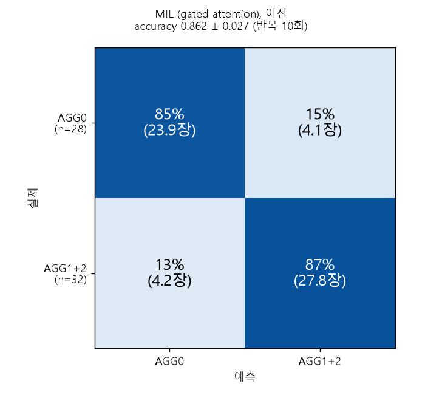
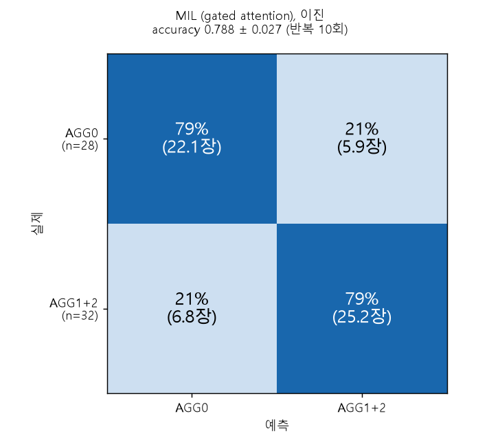

# MIL: DINOv2_grid_augmentation 타일 특징 위의 gated attention MIL (이진: AGG0 vs AGG1+AGG2)

DINOv2_grid_augmentation 의 타일 특징(DINOv2 ViT-B/14 cls 토큰 768차원, 겹치지 않는 224px 타일)을 이미지 1장 = bag, 타일 = instance 로 묶어 Ilse et al. (2018) 의 gated attention MIL 로 이진 분류하고, attention 이 무엇을 보는지 분석한다.
**목적은 정확도 향상이 아니라 attention 해석 가능성**이다. 점수가 baseline 보다 낮아도 그대로 보고한다.

## 데이터와 평가

- 이미지 60장 (10x 현미경): AGG0 28 / AGG1 14 / AGG2 18. 이진 라벨은 AGG0 = 0, AGG1·AGG2 = 1 (AGG1+2 가 양성 32장).
- 분석 타일 2,591개 (이미지당 36~48개). 그중 마스크 100% 타일(시편만 있는 타일) 1,309개, 가장자리·배경이 섞인 타일 1,282개.
- 평가는 다른 실험과 같은 분할: 이미지 단위 층화 5-fold x 10 반복 (e00), LOCO (처리 조건 1개 제외, 10 fold), LOMO (처리 방법 1개 제외, 5 fold).
- 학습 bag = 학습 이미지의 모든 버전 6개 (원본 + 배경 증강 5개), 평가 bag = 원본만.
- 비교 대상 baseline = 같은 타일 특징의 평균 + logistic regression.

## 모델과 학습 (결과를 보기 전에 고정, 탐색하지 않음)

특징 표준화(학습 타일로만 계산) -> FC(768→64) + ReLU + Dropout 0.25 -> gated attention (tanh x sigmoid, 64) -> softmax 가중합 -> Dropout 0.25 + FC.
Adam lr 1e-3, weight decay 1e-3, batch 16 bag, 40 epoch 고정 (조기 종료 없음), 클래스 가중 BCE, 시드 5개 앙상블.

## 결과 (accuracy)

분석 타일 전체 사용:

| 평가 | MIL | baseline | MIL − baseline (이미지 단위 95% CI) |
|---|---|---|---|
| 이미지 단위 분할 | 0.862 ± 0.027 | 0.898 ± 0.022 | -0.037 [-0.097, +0.018] |
| LOCO | 0.833 | 0.850 | -0.017 [-0.117, +0.083] |
| LOMO | 0.800 | 0.833 | -0.033 [-0.133, +0.067] |

- 세 평가 모두 MIL 과 baseline 의 차이를 구분할 수 없다 (CI 가 0 포함). MIL 점수가 baseline 보다 높지 않다.
- 라벨 순열 검사 (20회): 실제 점수가 세 평가 모두 순열 최댓값을 넘는다 (순열 평균 0.475~0.499).
- 처리 조건을 외우는 방식의 이진 기준선(0.933)은 넘지 못한다. 처리 조건과 라벨이 얽혀 있다는 문제는 이 실험으로 해소되지 않았다.
- 60장이라 신뢰구간이 넓다.

## attention 관찰과 해석

관찰 (LOCO fold 모델의 attention, 시드 5개 평균):
- AGG0 bag 의 attention 은 가장자리·배경이 섞인 타일에 쏠린다 (질량 70.2%, 그 타일의 비율 52.6%). AGG2 bag 은 반대로 그런 타일을 피한다 (질량 20.0%, 비율 44.0%). AGG1 은 중간이다.
- 시드끼리 attention 순위 상관 평균 0.80 (최소 0.37). 원본 bag 과 배경 증강 bag 사이 상관 평균 0.89.

해석 (가능한 설명이며 확정이 아님):
- attention 은 AGG 영역 라벨이 아니다. 이미지에 AGG 영역 위치 라벨이 없어서 attention 이 AGG 영역과 대응하는지는 검증하지 못했다. 그림에 대한 서술은 분석자의 육안 판독이며 도메인 전문가의 확인을 받지 않았다.
- attention 이 타일 구성(가장자리 여부)과 클래스에 강하게 연결돼 있으므로, 모델이 구성을 판단 근거로 썼을 가능성이 있다.

## 대조 실험

1. **마스크 100% 타일만 사용** (`config_full.yaml`, baseline 도 같은 타일로 재학습): MIL 0.810 / 0.800 / 0.833 (이미지 단위 / LOCO / LOMO), baseline 0.813 / 0.817 / 0.783. 차이는 구분되지 않는다. 가장자리 타일을 빼면 baseline 이 크게 떨어지므로 가장자리 타일에도 정보가 있다. 배경 증강은 이 타일의 픽셀을 바꾸지 않는다.
2. **가장자리 타일 비율만 feature 로 쓴 logreg** (`m17`): 0.578 / 0.583 / 0.417, 타일 수와 마스크 비율 등 구성 전체를 더해도 0.705 / 0.667 / 0.617. MIL (0.862 / 0.833 / 0.800) 보다 모두 유의하게 낮다. MIL 의 점수는 가장자리 비율만으로는 설명되지 않는다. 다만 시편 크기·타일 수가 일부 점수와 얽혀 있을 수 있고, 이 대조는 처리 조건, 색, 조명 같은 다른 교란을 배제하지 않는다.
3. **마스크 비율 0.2 이상 타일만 사용** (`config_mf02.yaml`, `tile_filter: min_frac`, `min_mask_frac: 0.2`, 타일 2,236개, baseline 도 같은 타일로 재학습): 시편 비율이 낮은 가장자리 타일을 bag 에서 뺀 판이다. 모델, 학습 절차, 하이퍼파라미터, 분할은 `config.yaml` 과 같다 (값은 결과를 보기 전에 고정했고 다른 값은 시도하지 않았다).

   | 평가 | MIL | baseline | MIL − baseline (이미지 단위 95% CI) |
   |---|---|---|---|
   | 이미지 단위 분할 | 0.788 | 0.827 | -0.038 [-0.102, +0.017] |
   | LOCO | 0.750 | 0.817 | -0.067 [-0.167, +0.033] |
   | LOMO | 0.783 | 0.767 | +0.017 [-0.083, +0.133] |

   - 세 평가 모두 MIL 과 baseline 의 차이를 구분할 수 없다 (CI 가 0 포함). 라벨 순열 검사 (20회): 실제 점수가 세 평가 모두 순열 최댓값을 넘는다 (이미지 단위 0.788 vs 순열 평균 0.468, 최대 0.567 / LOCO 0.750 vs 0.479, 0.617 / LOMO 0.783 vs 0.483, 0.633).
   - 점수는 모든 타일을 쓴 판보다 MIL (0.862 / 0.833 / 0.800) 과 baseline (0.898 / 0.850 / 0.833) 모두 내려갔다. 이미지 단위 혼동행렬(반복 10회 평균): AGG0 정답률 79% (22.1장), AGG1+2 79% (25.2장). 모든 타일 판은 85% / 87% 였다 (`m18`).
   - 관찰 (LOCO fold 모델, 시드 5개 평균): AGG0 bag 에서 배경이 섞인 타일이 받는 attention 질량은 45.3%, 그 타일의 비율은 43.8% 로 거의 같아졌다 (모든 타일 판은 70.2% 대 52.6%). AGG1 은 39.2% 대 46.6%, AGG2 는 14.5% 대 33.9% 로 배경이 섞인 타일을 피한다. 시드끼리 attention 순위 상관은 이미지 단위 평균 0.756 (최소 0.337), LOCO 평균 0.697 (최소 0.348), 원본 bag 과 배경 증강 bag 사이 상관은 0.94 였다.
   - 해석 (가능한 설명이며 확정이 아님): AGG0 에서 가장자리 타일로의 쏠림이 그 타일을 뺀 뒤 사라진 것은 쏠림이 shortcut 이었다는 가설과 맞는다. 그러나 점수도 같이 내려갔고 baseline 도 0.898 에서 0.827 로 내려갔으므로, 가장자리 타일이 방해물이 아니라 분류에 도움이 되는 정보(시편 크기, 가장자리 모양 등)를 담고 있었을 수도 있다. 그 정보가 AGG 인지 처리 조건과 얽힌 교란인지는 이 실험으로 가를 수 없다. 틀린 이미지의 attention 이 시편 가장자리 근처 타일에 몰리는 경우가 여전히 보이고, attention 이 AGG 영역을 가리킨다는 증거는 없다.
   - 이 판은 `m14` (관찰과 해석 보고서) 를 돌리지 않았다 (문구가 이전 설정에 맞춰져 있다).

## 혼동행렬 (이미지 단위 분할, `m18`)

이미지 단위 5-fold x 10 반복의 반복 평균 (칸 안은 이미지 수와 그 행(실제 클래스) 안의 비율). baseline 은 같은 타일 집합의 평균 + logreg 이다 (모든 타일 판의 baseline 은 `DINOv2_binary` 의 primary 와 같다).

| 타일 집합 | 방법 | accuracy | AGG0 → AGG0 | AGG0 → AGG1+2 | AGG1+2 → AGG0 | AGG1+2 → AGG1+2 |
|---|---|---|---|---|---|---|
| 모든 타일 | baseline | 0.898 | 25.7 (92%) | 2.3 (8%) | 3.8 (12%) | 28.2 (88%) |
| 모든 타일 | MIL | 0.862 | 23.9 (85%) | 4.1 (15%) | 4.2 (13%) | 27.8 (87%) |
| 마스크 비율 >= 0.2 | MIL | 0.788 | 22.1 (79%) | 5.9 (21%) | 6.8 (21%) | 25.2 (79%) |

MIL, 모든 타일 / MIL, 마스크 비율 >= 0.2 (`m18` 로 그렸다):

 

관찰: 모든 타일 판에서 MIL 과 baseline 의 차이는 주로 AGG0 을 AGG1+2 로 잘못 보는 비율(8% 에서 15%)에서 나고, AGG1+2 를 놓치는 비율은 비슷하다 (12% 와 13%). 정확도 차이 자체는 CI 가 0 을 포함해 구분되지 않는다. 마스크 비율 0.2 판은 두 방향 오류가 모두 늘었다. 이 표만으로 attention 쏠림과의 관계를 말할 수는 없다.

## 누수 점검

분할은 모두 기존 e00, LOCO, LOMO 를 그대로 사용하고 train/test 이미지 서로소, 학습 bag 은 학습 이미지에서만 생성, 표준화 통계는 학습 타일로만 계산함을 assert 로 확인했다. test 점수는 원본 bag 만으로 계산했다.

## 스크립트 (실행 순서)

| 스크립트 | 환경 | 내용 |
|---|---|---|
| `m10_train_eval_mil.py` | torch | 이미지 단위 / LOCO / LOMO 학습과 평가, attention 저장 |
| `m11_permutation_mil.py` | torch | 라벨 순열 검사 (20회 x 3 평가) |
| `m15_baseline_pooled_logreg.py` | sklearn | 같은 타일 집합의 평균 + logreg baseline (마스크 100% 비교용) |
| `m12_report.py` | numpy | MIL vs baseline 표, 부트스트랩 CI, fold 별 점수, 누수 점검 |
| `m13_attention_analysis.py`, `m14_write_attention_report.py` | numpy, cv2 | attention 통계, 오버레이 그림, 해석 보고서 |
| `m16_write_full_tiles_report.py` | numpy | 전체 타일 대 마스크 100% 타일 비교 |
| `m17_edge_ratio_logreg.py` | sklearn | 가장자리 비율만 쓴 logreg 대조 |
| `m18_confusion_figure.py` | numpy, matplotlib | 이미지 단위 분할의 혼동행렬 그림 (반복 10회 평균, 비율과 장 수) |

`mcommon.py` 는 모델(`GatedAttentionMIL`)과 학습 함수 등 공용 코드다. 마스크 100% 판은 `--config config_full.yaml` 로 m10, m11, m15, m12, m13 을 같은 순서로 돌린다. 마스크 비율 0.2 이상 판은 `--config config_mf02.yaml` 로 같은 순서로 돌린다 (선택: m18). `mcommon.py` 의 `tile_filter` 는 `all`(모든 분석 타일), `full`(마스크 100%), `min_frac`(마스크 비율 >= `min_mask_frac`) 을 지원한다.

## 제약

- 이 폴더의 코드는 저장소 안에서 그대로 실행되지 않는다. `mcommon.py` 가 `exp_binary/bcommon.py`, `exp_group_cv/gcommon.py` 를 import 하고, config 의 경로(`../exp_grid_aug/outputs`, `../exp/outputs/e00_make_splits` 등)는 로컬 작업 폴더 구조를 가정한다. 해당 폴더들은 이 저장소에 없다.
- 출력(예측, attention 배열, 보고서)과 위 혼동행렬 그림(`figures/`) 외의 그림은 올리지 않았다.
- 이미지 60장, 처리 조건 10개의 작은 데이터이고 라벨이 처리 조건과 얽혀 있어, 위 점수와 attention 해석은 모두 탐색적 관찰이다.
