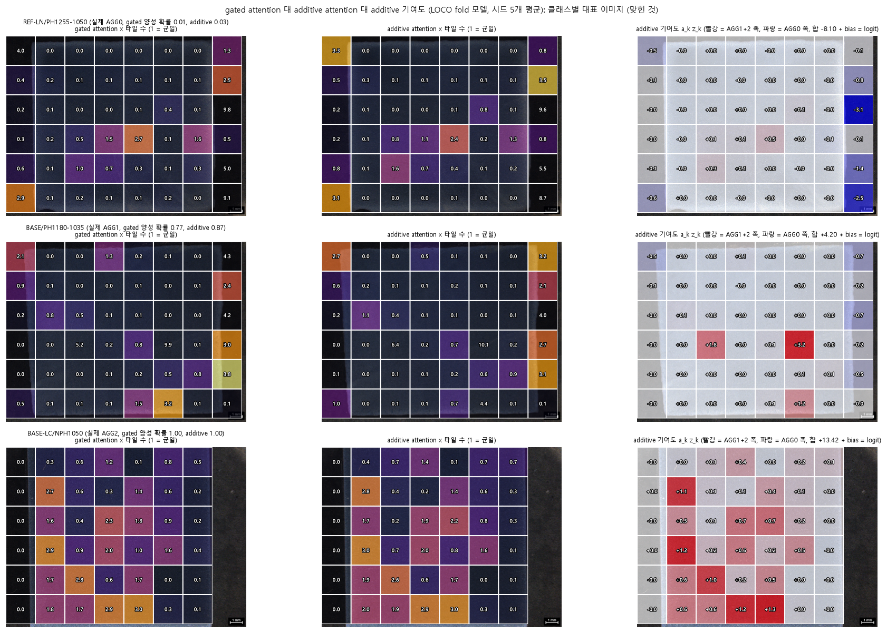
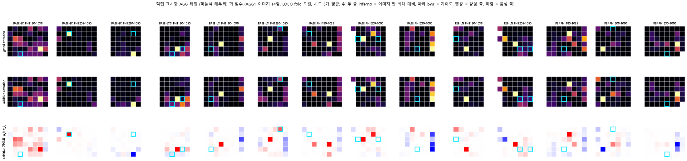

# MIL: DINOv2_grid_augmentation 타일 특징 위의 gated attention MIL (이진: AGG0 vs AGG1+AGG2)

DINOv2_grid_augmentation 의 타일 특징(DINOv2 ViT-B/14 cls 토큰 768차원, 겹치지 않는 224px 타일)을 이미지 1장 = bag, 타일 = instance 로 묶어 Ilse et al. (2018) 의 gated attention MIL 로 이진 분류하고, attention 이 무엇을 보는지 분석한다.
**목적은 정확도 향상이 아니라 attention 해석 가능성**이다. 점수가 baseline 보다 낮아도 그대로 보고한다.

## 데이터와 평가

- 이미지 60장 (10x 현미경): AGG0 28 / AGG1 14 / AGG2 18. 이진 라벨은 AGG0 = 0, AGG1·AGG2 = 1 (AGG1+2 가 양성 32장).
- 분석 타일 2,591개 (이미지당 36~48개). 그중 마스크 100% 타일(시편만 있는 타일) 1,309개, 가장자리·배경이 섞인 타일 1,282개.
- 평가는 다른 실험과 같은 분할: 이미지 단위 층화 5-fold x 10 반복 (e00), LOCO (처리 조건 1개 제외, 10 fold), LOMO (처리 방법 1개 제외, 5 fold).
- 학습 bag = 학습 이미지의 모든 버전 6개 (원본 + 배경 증강 5개), 평가 bag = 원본만.
- 비교 대상 baseline = 같은 타일 특징의 평균 + logistic regression.

## 모델과 학습 (결과를 보기 전에 고정, 탐색하지 않음)

특징 표준화(학습 타일로만 계산) -> FC(768→64) + ReLU + Dropout 0.25 -> gated attention (tanh x sigmoid, 64) -> softmax 가중합 -> Dropout 0.25 + FC.
Adam lr 1e-3, weight decay 1e-3, batch 16 bag, 40 epoch 고정 (조기 종료 없음), 클래스 가중 BCE, 시드 5개 앙상블.

## 결과 (accuracy)

분석 타일 전체 사용:

| 평가 | MIL | baseline | MIL − baseline (이미지 단위 95% CI) |
|---|---|---|---|
| 이미지 단위 분할 | 0.862 ± 0.027 | 0.898 ± 0.022 | -0.037 [-0.097, +0.018] |
| LOCO | 0.833 | 0.850 | -0.017 [-0.117, +0.083] |
| LOMO | 0.800 | 0.833 | -0.033 [-0.133, +0.067] |

- 세 평가 모두 MIL 과 baseline 의 차이를 구분할 수 없다 (CI 가 0 포함). MIL 점수가 baseline 보다 높지 않다.
- 라벨 순열 검사 (20회): 실제 점수가 세 평가 모두 순열 최댓값을 넘는다 (순열 평균 0.475~0.499).
- 처리 조건을 외우는 방식의 이진 기준선(0.933)은 넘지 못한다. 처리 조건과 라벨이 얽혀 있다는 문제는 이 실험으로 해소되지 않았다.
- 60장이라 신뢰구간이 넓다.

## attention 관찰과 해석

관찰 (LOCO fold 모델의 attention, 시드 5개 평균):
- AGG0 bag 의 attention 은 가장자리·배경이 섞인 타일에 쏠린다 (질량 70.2%, 그 타일의 비율 52.6%). AGG2 bag 은 반대로 그런 타일을 피한다 (질량 20.0%, 비율 44.0%). AGG1 은 중간이다.
- 시드끼리 attention 순위 상관 평균 0.80 (최소 0.37). 원본 bag 과 배경 증강 bag 사이 상관 평균 0.89.

해석 (가능한 설명이며 확정이 아님):
- attention 은 AGG 영역 라벨이 아니다. 이미지에 AGG 영역 위치 라벨이 없어서 attention 이 AGG 영역과 대응하는지는 검증하지 못했다. 그림에 대한 서술은 분석자의 육안 판독이며 도메인 전문가의 확인을 받지 않았다.
- attention 이 타일 구성(가장자리 여부)과 클래스에 강하게 연결돼 있으므로, 모델이 구성을 판단 근거로 썼을 가능성이 있다.

## 대조 실험

1. **마스크 100% 타일만 사용** (`config_full.yaml`, baseline 도 같은 타일로 재학습): MIL 0.810 / 0.800 / 0.833 (이미지 단위 / LOCO / LOMO), baseline 0.813 / 0.817 / 0.783. 차이는 구분되지 않는다. 가장자리 타일을 빼면 baseline 이 크게 떨어지므로 가장자리 타일에도 정보가 있다. 배경 증강은 이 타일의 픽셀을 바꾸지 않는다.
2. **가장자리 타일 비율만 feature 로 쓴 logreg** (`m17`): 0.578 / 0.583 / 0.417, 타일 수와 마스크 비율 등 구성 전체를 더해도 0.705 / 0.667 / 0.617. MIL (0.862 / 0.833 / 0.800) 보다 모두 유의하게 낮다. MIL 의 점수는 가장자리 비율만으로는 설명되지 않는다. 다만 시편 크기·타일 수가 일부 점수와 얽혀 있을 수 있고, 이 대조는 처리 조건, 색, 조명 같은 다른 교란을 배제하지 않는다.
3. **마스크 비율 0.2 이상 타일만 사용** (`config_mf02.yaml`, `tile_filter: min_frac`, `min_mask_frac: 0.2`, 타일 2,236개, baseline 도 같은 타일로 재학습): 시편 비율이 낮은 가장자리 타일을 bag 에서 뺀 판이다. 모델, 학습 절차, 하이퍼파라미터, 분할은 `config.yaml` 과 같다 (값은 결과를 보기 전에 고정했고 다른 값은 시도하지 않았다).

   | 평가 | MIL | baseline | MIL − baseline (이미지 단위 95% CI) |
   |---|---|---|---|
   | 이미지 단위 분할 | 0.788 | 0.827 | -0.038 [-0.102, +0.017] |
   | LOCO | 0.750 | 0.817 | -0.067 [-0.167, +0.033] |
   | LOMO | 0.783 | 0.767 | +0.017 [-0.083, +0.133] |

   - 세 평가 모두 MIL 과 baseline 의 차이를 구분할 수 없다 (CI 가 0 포함). 라벨 순열 검사 (20회): 실제 점수가 세 평가 모두 순열 최댓값을 넘는다 (이미지 단위 0.788 vs 순열 평균 0.468, 최대 0.567 / LOCO 0.750 vs 0.479, 0.617 / LOMO 0.783 vs 0.483, 0.633).
   - 점수는 모든 타일을 쓴 판보다 MIL (0.862 / 0.833 / 0.800) 과 baseline (0.898 / 0.850 / 0.833) 모두 내려갔다. 이미지 단위 혼동행렬(반복 10회 평균): AGG0 정답률 79% (22.1장), AGG1+2 79% (25.2장). 모든 타일 판은 85% / 87% 였다 (`m18`).
   - 관찰 (LOCO fold 모델, 시드 5개 평균): AGG0 bag 에서 배경이 섞인 타일이 받는 attention 질량은 45.3%, 그 타일의 비율은 43.8% 로 거의 같아졌다 (모든 타일 판은 70.2% 대 52.6%). AGG1 은 39.2% 대 46.6%, AGG2 는 14.5% 대 33.9% 로 배경이 섞인 타일을 피한다. 시드끼리 attention 순위 상관은 이미지 단위 평균 0.756 (최소 0.337), LOCO 평균 0.697 (최소 0.348), 원본 bag 과 배경 증강 bag 사이 상관은 0.94 였다.
   - 해석 (가능한 설명이며 확정이 아님): AGG0 에서 가장자리 타일로의 쏠림이 그 타일을 뺀 뒤 사라진 것은 쏠림이 shortcut 이었다는 가설과 맞는다. 그러나 점수도 같이 내려갔고 baseline 도 0.898 에서 0.827 로 내려갔으므로, 가장자리 타일이 방해물이 아니라 분류에 도움이 되는 정보(시편 크기, 가장자리 모양 등)를 담고 있었을 수도 있다. 그 정보가 AGG 인지 처리 조건과 얽힌 교란인지는 이 실험으로 가를 수 없다. 틀린 이미지의 attention 이 시편 가장자리 근처 타일에 몰리는 경우가 여전히 보이고, attention 이 AGG 영역을 가리킨다는 증거는 없다.
   - 이 판은 `m14` (관찰과 해석 보고서) 를 돌리지 않았다 (문구가 이전 설정에 맞춰져 있다).

## 혼동행렬 (이미지 단위 분할, `m18`)

이미지 단위 5-fold x 10 반복의 반복 평균 (칸 안은 이미지 수와 그 행(실제 클래스) 안의 비율). baseline 은 같은 타일 집합의 평균 + logreg 이다 (모든 타일 판의 baseline 은 `DINOv2_binary` 의 primary 와 같다).

| 타일 집합 | 방법 | accuracy | AGG0 → AGG0 | AGG0 → AGG1+2 | AGG1+2 → AGG0 | AGG1+2 → AGG1+2 |
|---|---|---|---|---|---|---|
| 모든 타일 | baseline | 0.898 | 25.7 (92%) | 2.3 (8%) | 3.8 (12%) | 28.2 (88%) |
| 모든 타일 | MIL | 0.862 | 23.9 (85%) | 4.1 (15%) | 4.2 (13%) | 27.8 (87%) |
| 마스크 비율 >= 0.2 | MIL | 0.788 | 22.1 (79%) | 5.9 (21%) | 6.8 (21%) | 25.2 (79%) |

MIL, 모든 타일 / MIL, 마스크 비율 >= 0.2 (`m18` 로 그렸다):

 

관찰: 모든 타일 판에서 MIL 과 baseline 의 차이는 주로 AGG0 을 AGG1+2 로 잘못 보는 비율(8% 에서 15%)에서 나고, AGG1+2 를 놓치는 비율은 비슷하다 (12% 와 13%). 정확도 차이 자체는 CI 가 0 을 포함해 구분되지 않는다. 마스크 비율 0.2 판은 두 방향 오류가 모두 늘었다. 이 표만으로 attention 쏠림과의 관계를 말할 수는 없다.

## Additive MIL 대조 실험

**목적은 정확도 향상이 아니라 attention(기여도) 해석 가능성이다.** gated MIL 의 attention `a_k` 는 pooling 단계에서 그 타일이 평균 표현에 얼마나 들어갔는지일 뿐이고, 분류기가 그 평균 표현 전체에 적용되므로 `a_k` 가 크다고 해서 그 타일이 최종 판단에 기여했다는 보장이 없다. 위 "attention 관찰과 해석" 에서 AGG0 이미지의 attention 이 가장자리·배경이 섞인 타일에 쏠린다는 관찰이 AGG 판단의 근거인지 shortcut 인지 구분되지 않았던 것이 이 구조 때문이다. 그래서 pooling 과 분류기의 합성 순서를 바꾼 additive 판 (Javed et al. 2022 의 Additive MIL 식) 으로 같은 질문을 다시 본다.

- 기존: `logit = head( sum_k a_k h_k )` (분류기가 pooling 뒤). additive: `z_k = head(h_k)`, `logit = sum_k a_k z_k + b` (분류기가 pooling 앞, 타일별 head 는 bias 없음, bag bias `b` 하나). 이때 `a_k z_k` 가 그 타일이 bag logit 에 더한 정확한 기여도이고, 기여도의 합 + `b` 가 bag logit 이다. embed 와 attention 부분은 기존과 같은 구조다 (`mcommon.py` 의 `AdditiveGatedAttentionMIL`, 기존 `GatedAttentionMIL` 은 바꾸지 않음).
- `config_additive.yaml`: `config.yaml` 과 `mil.model_type: additive`, `outputs_dir` 만 다르다. 하이퍼파라미터 (embed 64, attention 64, dropout 0.25, L2 1e-3, lr 1e-3, 40 epoch 고정, 시드 5개 앙상블), 분할, 타일 집합은 결과를 보기 전에 고정했고 탐색하지 않았다. 순열 검사(`m11`)는 additive 판에서는 돌리지 않았다.
- **회귀 확인 (gated 가 그대로인지)**: `config.yaml` 로 `m10` 을 다시 돌려 기존 결과와 비교했다. `mil_summary.csv`, `mil_predictions.csv`, `mil_fold_accuracy.csv` 는 파일이 바이트 단위로 같고, `attention_arrays.npz` 의 `att_*` 배열도 모두 같다 (accuracy 0.862 / 0.833 / 0.800). 기존 `outputs/` 의 `attention_tiles.csv` 는 stride 224 전환 전 타일 번호(`tile_id`)를 쓰고 새 실행은 새 번호를 쓰지만 이미지, 타일 좌표 (x0, y0), 순서는 같다 (두 run 의 좌표와 순서가 같음을 `m20`, `m21` 에서 assert 로 확인).
- 이 폴더의 기존 코드 변경: `predict_mil` 이 `(확률, attention, 기여도)` 를 반환한다 (gated 는 기여도 목록이 `None`), `train_mil` 이 `model_type` 으로 모델을 고른다 (지정하지 않으면 gated), `m10` 은 additive 일 때만 `contrib_*` 배열을 추가로 저장한다.

### 점수 (accuracy)

| 평가 | gated MIL | additive MIL | baseline (패치 평균 + logreg) | additive − gated (이미지 단위 CI) | gated − baseline (이미지 단위 CI) | additive − baseline (이미지 단위 CI) |
|---|---|---|---|---|---|---|
| 이미지 단위 분할 | 0.862 ± 0.027 [0.793, 0.920] | 0.872 ± 0.031 [0.803, 0.932] | 0.898 ± 0.022 [0.835, 0.952] | +0.010 [-0.005, +0.025] | -0.037 [-0.097, +0.018] | -0.027 [-0.083, +0.028] |
| LOCO | 0.833 [0.733, 0.917] | 0.867 [0.783, 0.950] | 0.850 [0.750, 0.933] | +0.033 [0.000, +0.083] | -0.017 [-0.117, +0.083] | +0.017 [-0.083, +0.117] |
| LOMO | 0.800 [0.700, 0.900] | 0.783 [0.683, 0.883] | 0.833 [0.733, 0.917] | -0.017 [-0.050, 0.000] | -0.033 [-0.133, +0.067] | -0.050 [-0.150, +0.033] |

- 사실: 세 평가 모두 additive 와 gated, additive 와 baseline 의 차이는 CI 가 0 을 포함하거나 0 에 닿는다 (구분되지 않는다). additive 판이 정확도를 떨어뜨렸다고 할 근거도, 올렸다고 할 근거도 없다. 모델이 달라져도 처리 조건 암기 기준선 (이진 0.933) 은 넘지 못한다.

### attention 기준 대 기여도 기준 지표 (LOCO fold 모델, 시드 5개 평균, 이미지 평균)

기여도 `c_k = a_k z_k` 는 부호가 있다. 시드 평균 `c_k` 를 구한 뒤 양의 부분 (`contrib_pos`, AGG1+2 쪽으로 미는 타일) 과 음의 부분 (`contrib_neg`, AGG0 쪽으로 미는 타일) 을 각각 이미지마다 합 1 로 정규화해서 attention 과 같은 지표 (A1 가중치 질량, A4 상위 10% 구성) 를 계산했다. 배경이 섞인 타일 = 마스크 비율 < 1 인 타일. 전체 수치는 `outputs_additive/m21_contribution_analysis/` 에 있다.

| 이미지 그룹 | 가중치 기준 | 배경 섞인 타일이 받은 질량 | 그 타일의 비율 | 배율 | 상위 10% 타일 중 배경 섞인 비율 (기대) |
|---|---|---|---|---|---|
| AGG0 (28장) | gated attention | 0.702 | 0.526 | 1.33 | 0.768 (0.526) |
| AGG0 | additive attention | 0.666 | 0.526 | 1.27 | 0.711 (0.526) |
| AGG0 | 기여도 음의 부분 (AGG0 쪽) | 0.819 | 0.526 | 1.56 | 0.782 (0.526) |
| AGG0 | 기여도 양의 부분 (AGG1+2 쪽) | 0.360 | 0.526 | 0.68 | 0.323 (0.526) |
| AGG1 (14장) | gated attention | 0.427 | 0.517 | 0.83 | 0.489 (0.517) |
| AGG1 | additive attention | 0.484 | 0.517 | 0.94 | 0.546 (0.517) |
| AGG1 | 기여도 양의 부분 (AGG1+2 쪽) | 0.268 | 0.517 | 0.52 | 0.282 (0.517) |
| AGG1 | 기여도 음의 부분 (AGG0 쪽) | 0.788 | 0.517 | 1.52 | 0.793 (0.517) |
| AGG2 (18장) | gated attention | 0.200 | 0.440 | 0.46 | 0.042 (0.440) |
| AGG2 | additive attention | 0.242 | 0.440 | 0.55 | 0.056 (0.440) |
| AGG2 | 기여도 양의 부분 (AGG1+2 쪽) | 0.131 | 0.440 | 0.30 | 0.014 (0.440) |
| AGG2 | 기여도 음의 부분 (AGG0 쪽, 음의 기여가 있는 16장) | 1.000 | 0.425 | 2.35 | 0.969 (0.425) |

부호 있는 기여도의 합 (logit 단위, 이미지 평균):

| 이미지 그룹 | 배경 섞인 타일들의 합 | 안쪽 타일들의 합 | 전체 합 (= bag logit − bias) |
|---|---|---|---|
| AGG0 | -5.15 | +0.07 | -5.08 |
| AGG1 | -1.73 | +3.02 | +1.29 |
| AGG2 | +0.98 | +11.12 | +12.10 |

- 안정성 (Spearman, LOCO): 기여도의 시드끼리 순위 상관 평균 0.827 (최소 0.521), 원본 대 배경 증강 bag 0.924 (최소 0.737). gated attention 은 0.799 (최소 0.366), 0.892 (최소 0.717), additive attention 은 0.749, 0.886.

**관찰 (측정값)**
- gated attention 의 기존 관찰이 재현된다 (AGG0 배율 1.33, AGG2 0.46). additive 판의 attention 도 같은 방향이다 (AGG0 1.27, AGG2 0.55).
- 기여도 기준으로 보면 AGG0 이미지에서 bag logit 을 AGG0 쪽으로 미는 음의 기여는 배경이 섞인 타일에 쏠린다 (질량 0.819, 타일 비율 0.526, 상위 10% 타일 중 0.782). 부호 있는 합으로 보면 AGG0 이미지의 bag logit (평균 -5.08) 은 거의 전부 배경 섞인 타일들의 합 (-5.15) 이고 안쪽 타일의 합은 약 0 (+0.07) 이다.
- AGG1, AGG2 이미지에서 양의 기여 (AGG1+2 쪽) 는 안쪽 타일에 쏠린다 (배경 섞인 타일 질량 0.268, 0.131). AGG2 이미지의 음의 기여는 있다면 전부 배경 섞인 타일에 있다 (질량 1.000).
- 기여도는 attention 보다 이미지 안에 소수 타일에 집중되고 (effective number / 타일 수 0.09~0.49 대 attention 0.32~0.65) 순위가 시드와 배경 증강에 대해 attention 만큼 또는 더 안정적이다.

**해석 (가능한 설명이며 확정이 아님)**
- 기존 해석에서 가능성으로만 남겨 둔 것, 즉 AGG0 에서 attention 이 가장자리·배경 섞인 타일에 쏠리는 것이 판단 근거와 연결되는지는, 이 additive 판에서는 연결되는 쪽으로 보인다. AGG0 이라는 판단 (음의 logit) 이 주로 배경이 섞인 타일에서 나오고, AGG1+2 라는 판단은 주로 안쪽 타일에서 나온다. 가장자리 타일 정보가 "AGG 없음" 쪽 증거로 쓰인다는 해석과 양립한다. 앞서 본 가장자리 비율만 쓴 logreg (0.42~0.58) 가 낮았던 것과 함께 보면, 단순한 가장자리 타일 수가 아니라 가장자리 타일의 내용이 쓰이는 것일 수 있다. 이것이 배경 픽셀 자체인지 시편 가장자리 근처의 질감인지는 이 실험으로 구분할 수 없다. 마스크 100% 타일만 쓴 이전 대조에서 MIL 점수가 유지된 것과도 모순되지 않는다 (안쪽 타일에도 정보가 있음).
- additive 판의 기여도를 AGG 위치의 증거로 읽을 수는 없다. 이미지에 AGG 영역 라벨이 없고, 안쪽 타일에 양의 기여가 몰린다는 것은 "AGG1+2 이미지는 안쪽 타일에서 양성으로 판단된다" 는 뜻이지 그 타일에 AGG 가 있다는 뜻이 아니다. 라벨이 처리 조건과 얽혀 있어 (NPH 12장 등) 처리 조건의 외형을 본 것일 수도 있다.

### 직접 표시한 AGG 타일 17개로 검증 (`m20`)

AGG1 이미지 14장에서 직접 표시한 AGG 타일 17개 (안쪽 9, 가장자리 8, `../DINOv2_aggsim` 의 `c08`) 가 attention 또는 기여도에서 그 이미지 안 상위로 나오는지 본다. 방식은 `c09` 의 `rank_pct` 와 같다 (이미지 안 순위, percentile = 1 − (rank − 1)/(n − 1), 1.0 = 최상위, 무작위 평균 0.5, 상위 25% 이내 개수의 무작위 기대 약 4.3/17). `c09` 의 prototype 은 그 17개로 만들어 순환성 보정이 필요했지만, MIL 은 이미지 단위 라벨로만 학습되고 이 타일 위치를 보지 않으므로 보정 없이 쓴다. 점수는 그 이미지를 시험으로 뺀 fold 모델의 값 (LOCO), 시드 5개 평균이다. 기여도는 부호 있는 `a_k z_k` 이고 클수록 AGG1+2 쪽으로 더 많이 기여한다. 무작위 대조는 `m19` 와 같은 순열 (20,000회, 위치 통제 = 같은 이미지에서 같은 종류의 타일끼리).

| 점수 소스 (LOCO) | percentile 평균 (중앙값) | 상위 25% 이내 | 안쪽 표시 타일 9개 percentile (상위 25% 이내) | 가장자리 표시 타일 8개 percentile | p (위치 무시 / 위치 통제) | 이미지 1위 / 3위 안에 든 이미지 (14장 중) |
|---|---|---|---|---|---|---|
| gated attention | 0.576 (0.681) | 5 / 17 | 0.632 (3 / 9) | 0.514 | 0.145 / 0.103 | 1 / 2 |
| additive attention | 0.583 (0.657) | 4 / 17 | 0.603 (1 / 9) | 0.561 | 0.120 / 0.082 | 1 / 2 |
| additive 기여도 (`a_k z_k`) | 0.636 (0.745) | 8 / 17 | 0.744 (5 / 9) | 0.515 | 0.027 / 0.032 | 1 / 2 |

이미지 단위 분할 모델에서는 세 소스가 모두 0.65 근처이고 (gated 0.647, additive attention 0.655, 기여도 0.652), LOMO 에서는 기여도 0.641 (상위 25% 이내 9/17), additive attention 0.614, gated attention 0.583 이다. 전체 수치는 `outputs_additive/m20_validate_manual_agg/summary.md`, `manual_tile_scores.csv` (AGG1 이미지 14장의 모든 타일의 점수와 순위), 타일 격자 그림은 `figures/fig_additive_manual_tiles_LOCO.png` 에 있다.

**관찰 (측정값)**
- gated attention 의 값은 기존 `m19` 와 같다 (LOCO percentile 0.576, p 0.145/0.103). additive 판으로 바꿔도 attention 은 거의 같다 (0.583).
- 기여도 기준에서는 LOCO 에서 percentile 평균 0.636 (중앙값 0.745), 상위 25% 이내 8/17 (무작위 기대 약 4.3), 안쪽 표시 타일 9개에서 0.744 (5/9 가 상위 25%, 무작위 기대 약 2.3) 이고 위치 통제 p = 0.032 이다. 가장자리 표시 타일 8개는 0.515 (무작위와 같은 수준) 이다.
- 그러나 표시한 타일이 이미지에서 기여도 1위인 이미지는 14장 중 1장, 3위 안에 든 이미지는 2장이다. 표시한 타일이 가장 높은 기여를 하는 경우는 드물다.

**해석 (가능한 설명이며 확정이 아님)**
- 기여도 기준이 attention 기준보다 표시한 타일 쪽으로 약간 더 치우쳤지만 (percentile 0.58 에서 0.64, 안쪽 타일에서 0.60 에서 0.74), 그 정도는 작고 attention 에서 기여도로 바꾸면 엣지로 쏠리던 가중치가 표시한 AGG 타일로 옮겨 간다고 말할 수준은 아니다. 표시한 타일은 대체로 이미지의 중상위에 있을 뿐 최상위가 아니다.
- p 값은 검정 3 scheme × 3 소스를 보정하지 않은 값이고 (이미지 단위 분할에서는 gated attention 도 p = 0.018/0.017 이다), 표시한 타일 17개로는 구간 추정도 하지 못했다. 안쪽 타일이 percentile 이 높고 가장자리 타일이 낮은 것은 "기여도가 안쪽 타일에 몰린다" 는 위 관찰과 같은 현상일 수 있어서, 표시한 타일에 AGG 가 있어서라고 단정할 수 없다 (위치 통제 순열이 이를 부분적으로만 통제한다).

### 한계

1. 이미지 60장, AGG1 14장뿐이고 직접 표시한 타일 17개로 검증했다. 신뢰구간이 넓고 percentile 의 신뢰구간은 계산하지 않았다.
2. 표시는 AGG1 이미지에서 이미지당 1~2개이고, 표시하지 않은 타일에 AGG 가 없다고 보장되지 않는다. AGG2 이미지는 표시가 없다. 표시는 한 사람이 PPT 를 보고 정했고 도메인 전문가의 검증을 거치지 않았다. 타일 경계 부근이라고 적은 3건은 이름을 적은 타일만 썼다.
3. 라벨이 처리 조건과 얽혀 있어, 기여도가 AGG 를 본 것인지 처리 조건의 외형을 본 것인지는 구분되지 않는다. LOCO 에서도 같은 처리 방법의 다른 온도 조건이 학습에 남는다.
4. additive 판은 같은 하이퍼파라미터를 그대로 쓴 한 번의 실행이다 (탐색 없음). 순열 검사와 마스크 100% 타일 대조는 additive 판에서 하지 않았다.
5. Javed et al. 의 실험 결과 (병리 데이터 수치) 는 이 데이터셋에 인용하지 않았고, 위 수치는 모두 이 폴더의 실험에서 나온 것이다.

## 누수 점검

분할은 모두 기존 e00, LOCO, LOMO 를 그대로 사용하고 train/test 이미지 서로소, 학습 bag 은 학습 이미지에서만 생성, 표준화 통계는 학습 타일로만 계산함을 assert 로 확인했다. test 점수는 원본 bag 만으로 계산했다.

## 스크립트 (실행 순서)

| 스크립트 | 환경 | 내용 |
|---|---|---|
| `m10_train_eval_mil.py` | torch | 이미지 단위 / LOCO / LOMO 학습과 평가, attention 저장 |
| `m11_permutation_mil.py` | torch | 라벨 순열 검사 (20회 x 3 평가) |
| `m15_baseline_pooled_logreg.py` | sklearn | 같은 타일 집합의 평균 + logreg baseline (마스크 100% 비교용) |
| `m12_report.py` | numpy | MIL vs baseline 표, 부트스트랩 CI, fold 별 점수, 누수 점검 |
| `m13_attention_analysis.py`, `m14_write_attention_report.py` | numpy, cv2 | attention 통계, 오버레이 그림, 해석 보고서 |
| `m16_write_full_tiles_report.py` | numpy | 전체 타일 대 마스크 100% 타일 비교 |
| `m17_edge_ratio_logreg.py` | sklearn | 가장자리 비율만 쓴 logreg 대조 |
| `m18_confusion_figure.py` | numpy, matplotlib | 이미지 단위 분할의 혼동행렬 그림 (반복 10회 평균, 비율과 장 수) |
| `m20_validate_manual_agg.py` | numpy, matplotlib | 직접 표시한 AGG 타일 17개의 이미지 안 순위 (gated attention, additive attention, additive 기여도), `config_additive.yaml` 로 `m10` 을 돌린 뒤 실행 |
| `m21_contribution_analysis.py` | numpy, cv2, matplotlib | attention 기준 대 기여도 기준의 A1~A4 지표, 부호 있는 기여도 합, 대표 이미지 오버레이 |
| `m22_gated_vs_additive.py` | numpy | gated 와 additive 의 accuracy 를 같은 이미지끼리 짝지은 부트스트랩 비교 |

`mcommon.py` 는 모델(`GatedAttentionMIL`, additive 판 `AdditiveGatedAttentionMIL`)과 학습 함수 등 공용 코드다. Additive MIL 대조는 `--config config_additive.yaml` 로 `m10`, `m12` 를 돌리고 (`mil.model_type: additive`), `m20`, `m21`, `m22` 를 이어서 실행한다. 마스크 100% 판은 `--config config_full.yaml` 로 m10, m11, m15, m12, m13 을 같은 순서로 돌린다. 마스크 비율 0.2 이상 판은 `--config config_mf02.yaml` 로 같은 순서로 돌린다 (선택: m18). `mcommon.py` 의 `tile_filter` 는 `all`(모든 분석 타일), `full`(마스크 100%), `min_frac`(마스크 비율 >= `min_mask_frac`) 을 지원한다.

## 제약

- 이 폴더의 코드는 저장소 안에서 그대로 실행되지 않는다. `mcommon.py` 가 `exp_binary/bcommon.py`, `exp_group_cv/gcommon.py` 를 import 하고, config 의 경로(`../exp_grid_aug/outputs`, `../exp/outputs/e00_make_splits` 등)는 로컬 작업 폴더 구조를 가정한다. 해당 폴더들은 이 저장소에 없다.
- 출력(예측, attention 배열, 보고서)과 위 혼동행렬 그림(`figures/`) 외의 그림은 올리지 않았다.
- 이미지 60장, 처리 조건 10개의 작은 데이터이고 라벨이 처리 조건과 얽혀 있어, 위 점수와 attention 해석은 모두 탐색적 관찰이다.
