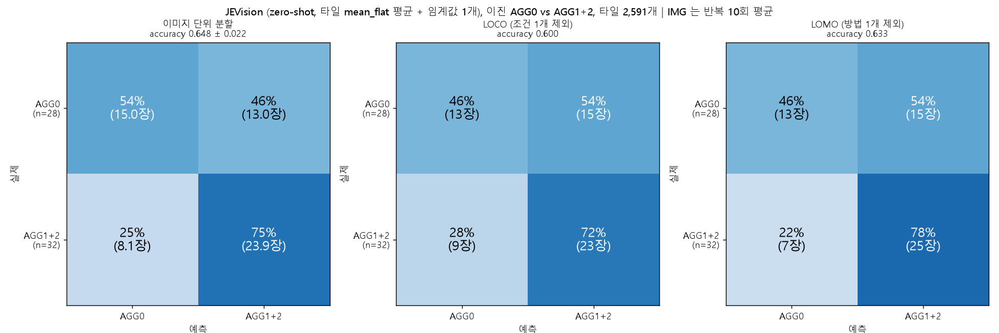

# JEVision 이진 평가 (AGG0 vs AGG1+AGG2), 타일 점수를 선택(choice) 형식으로 얻은 판 (jv06)

`../jev` 의 JEVision(0.8B) zero-shot 타일 방식을 이진(AGG0 = 음성, AGG1+AGG2 = 양성) 분류로 평가한다. 프롬프트 문구는 `../jev/scripts/run_tiles.py` 의 것을 그대로 쓰고, **`flat` 질문의 형식만** yes/no 확률(`noul`)에서 **두 선택지 중 하나를 고르는 `choice` 형식**으로 바꿨다. 선택지 순서를 바꿔 타일마다 2번 묻는다. 학습은 하지 않았고 임계값 하나만 학습 fold 에서 고른다.
이 폴더는 같은 설계에서 설명문만 보강한 `../jev_binary_choice_v2` (jv07), 예시 이미지를 더한 `../jev_binary_fewshot` (jv08) 의 기준 실험이다.

## 1. 한눈에 보기

| 평가 | accuracy (`mean_flat`, primary) | 이미지 단위 95% CI | DINOv2 이진 primary (참고) |
|---|---|---|---|
| 이미지 단위 분할 (IMG) | 0.648 ± 0.022 | [0.532, 0.760] | 0.898 |
| LOCO | 0.600 | [0.467, 0.717] | 0.850 |
| LOMO | 0.633 | [0.500, 0.750] | 0.833 |

- 처리 조건 암기 규칙(0.933)보다 낮고, 같은 온도 다수 라벨 규칙(0.667)과는 구분되지 않는다. LOCO 는 라벨 순열 검사를 통과하지 못했다.
- **선택지 순서 편향이 매우 크다**: 첫 번째로 적힌 선택지를 고르는 쪽으로 쏠린다 (아래 4절). 선택 결과(직접 선택)보다 두 순서를 평균한 확률이 점수로 더 쓸 만하다.
- 타일 라벨은 이미지 라벨의 복사라서 "타일에 AGG 가 있는가"의 정답이 없다. 평가는 이미지 단위로만 한다.

## 2. 설정

- 이미지: 10x 60장. AGG0 28 / AGG1 14 / AGG2 18 → 음성 28 / 양성 32 (다수 클래스 0.533).
- 타일: `DINOv2_grid_augmentation` 의 분석 타일 2,591개 (224px, 서로 겹치지 않음, 이미지당 36~48개, 가장자리와 배경이 섞인 타일 포함). 타일 하나를 이미지 1장으로 보낸다.
- **프롬프트** (영어, `run_tiles.py` 와 글자 그대로 같음; 라벨 단어는 없음)
  - 설명문(`state`): "The attached image is a small crop (about 2 mm wide) of the surface of a metal sample after heat treatment. A normal surface shows a uniform fine granular texture. Abnormal grain growth (AGG) shows up as regions that differ from the surrounding texture, typically flat, smooth patches within the fine texture."
  - `flat` 질문: "Does this crop contain a flat, smooth region that differs from the surrounding fine texture?" 선택지 `NO_FLAT_REGION` = "No: the texture is uniform across the crop." / `FLAT_REGION` = "Yes: there is a flat, smooth region that differs from the surrounding texture."
  - `extent` 질문 (NONE / PARTIAL / MOST)은 `run_tiles.py` 와 같고 이미지 점수에는 쓰지 않는다.
- **선택지 순서 교차**: 타일마다 2번 묻는다 (A: `NO_FLAT_REGION` 먼저, B: `FLAT_REGION` 먼저). `p_flat` = 두 순서의 `P(FLAT_REGION)` 평균, 직접 선택은 평균 확률이 큰 쪽(`p_flat > 0.5` 이면 `FLAT_REGION`).
- 이미지 점수: 이미지 안 타일 `p_flat` 의 평균 (`mean_flat`, primary) 또는 `p_flat > 0.5` 인 타일의 비율 (`frac_flat`, 보조).
- 분류: 점수 ≥ 임계값 이면 AGG1+2. 임계값은 학습 이미지의 점수값 중 학습 accuracy 가 처음으로 최대가 되는 값이고 **학습 fold 이미지에서만** 고른다 (test 점수는 예측에만 쓴다, 분할 서로소, 학습에 두 클래스 존재를 assert 로 확인).
- 평가: 이미지 단위 층화 5-fold x 10 반복 (IMG, `DINOv2` 의 e00 분할), LOCO (처리 조건 1개 제외, 10 fold), LOMO (처리 방법 1개 제외, 5 fold). 이미지 단위/처리 조건 단위 부트스트랩 95% CI (2000회), 라벨 순열 검사 20회.
- 사전 점검과 중단 규칙: 본 실행 전에 라벨을 쓰지 않고 타일 100개로 시험했다. "선택이 한쪽으로 95% 넘게 쏠리면 멈춘다"는 규칙을 정해 두었는데 시험에서 두 순서 평균 확률 기준 100% 가 `FLAT_REGION` 이어서 규칙에 해당했다 (순서 A 58%, 순서 B 100%). 이 결과를 보고한 뒤 사용자가 진행하기로 해서 전체를 실행했다. 문구는 고치지 않았다.

## 3. 결과

| 평가 | `mean_flat` | `frac_flat` | balanced acc (`mean_flat`) | recall AGG0 / AGG1+2 (`mean_flat`) |
|---|---|---|---|---|
| IMG | 0.648 ± 0.022 | 0.653 ± 0.010 | 0.641 | 0.54 / 0.75 |
| LOCO | 0.600 | 0.633 | 0.592 | 0.46 / 0.72 |
| LOMO | 0.633 | 0.633 | 0.623 | 0.46 / 0.78 |

혼동행렬 (primary, IMG 는 반복 10회 평균, LOCO/LOMO 는 60장 pooled):

| 평가 | AGG0 → AGG0 | AGG0 → AGG1+2 | AGG1+2 → AGG0 | AGG1+2 → AGG1+2 |
|---|---|---|---|---|
| IMG | 15.0 (54%) | 13.0 (46%) | 8.1 (25%) | 23.9 (75%) |
| LOCO | 13 | 15 | 9 | 23 |
| LOMO | 13 | 15 | 7 | 25 |

**기준선과의 비교** (primary − 기준선, 이미지 단위 95% CI)

| 평가 | 다수 클래스 | 같은 온도 다수 라벨 | 처리 조건 암기 |
|---|---|---|---|
| IMG | +0.115 [-0.035, +0.267] | -0.019 [-0.200, +0.148] | **-0.285 [-0.413, -0.162]** |
| LOCO | +0.369 [+0.217, +0.517] | -0.067 [-0.250, +0.117] | - |
| LOMO | +0.467 [+0.333, +0.600] | -0.034 [-0.217, +0.150] | - |

기준선 accuracy: 학습 fold 다수 클래스 0.533 (IMG), 같은 온도 다수 라벨 0.667, 같은 처리 조건 다수 라벨(처리 조건 암기) 0.933 (IMG), 항상 AGG0 0.467. (LOCO/LOMO 의 다수 클래스 값은 학습 fold 구성 때문에 0.233 / 0.167 로 낮게 나와 비교 대상으로 적절하지 않다.)

**라벨 순열 검사** (20회, 임계값 선택부터 다시): IMG 실제 0.648 vs 순열 최댓값 0.583 (초과), **LOCO 실제 0.600 vs 최댓값 0.600 (초과하지 못함)**, LOMO 실제 0.633 vs 최댓값 0.583 (초과).

**임계값 무관 AUROC** (이미지 점수, AGG1+2 가 양성, 이미지 부트스트랩 95% CI, 0.5 = 구분 못 함)

| 점수 | 타일 | AUROC |
|---|---|---|
| `p_flat` (두 순서 평균) | 전체 | 0.707 [0.571, 0.833] |
| `p_flat` | 안쪽(마스크 100%) 1,309개만 | 0.807 [0.694, 0.912] |
| `p_A` (NO 먼저) / `p_B` (FLAT 먼저) | 전체 | 0.699 / 0.766 |

## 4. 관찰과 해석

관찰:
- **선택지 순서 효과**: `FLAT_REGION` 을 고른 비율이 순서 A 58.6%, 순서 B 100.0%, 두 순서 평균 확률 기준 99.2%. 두 순서의 `P` 차이(`|P_A - P_B|`) 평균 0.363 (최대 0.84), 두 순서에서 선택이 서로 다른 타일 41.4%.
- 가장자리 타일을 빼면 AUROC 가 올라간다 (0.707 → 0.807). 가장자리와 배경이 섞인 타일이 점수를 흐린다.
- 직접 표시한 AGG 타일 17개(`../DINOv2_aggsim` 의 `c08`)의 이미지 안 percentile 평균은 0.495 (무작위 기대 0.5, 중앙값 0.511). 안쪽 타일 9개는 0.282, 가장자리 타일 8개는 0.734. 이미지 안 상위 25% 이내가 4개 (무작위 기대 약 4.2개).
- 처리 조건별 평균 `mean_flat` 은 0.791~0.858 로 좁게 몰려 있다.

해석 (가능한 설명이며 확정이 아님):
- 이 모델은 두 선택지 중 고르는 방식에서 내용보다 선택지 순서에 크게 좌우되는 것으로 보인다. 그래서 직접 선택(hard choice)은 의미가 약하고, 두 순서를 평균한 연속 확률만 약한 순위 정보를 담는다.
- 표시한 AGG 타일의 점수가 무작위 수준이라서, 이 점수가 AGG 의 위치를 가리킨다고 말할 수 없다. 이미지 단위 점수가 AGG 를 읽은 것인지 처리 조건의 외형을 읽은 것인지는 이 평가로 가를 수 없다 (처리 조건 암기 기준선이 0.933).
- 같은 이미지에 대해 yes/no 형식(`noul`)으로 물은 이전 실험(accuracy 0.680 / 0.683 / 0.700, 이 저장소에는 올리지 않음)보다 낮은 값이다. 이 둘의 차이에 대한 CI 는 계산하지 않았다.

## 5. 한계

- 라벨과 처리 조건이 얽혀 있다 (처리 조건으로 라벨을 맞히면 90% 이상). 점수가 AGG 를 본 것인지 처리 조건의 외형을 본 것인지 분리하지 못했다.
- 이미지 60장 (AGG1 14장) 이라 신뢰구간이 넓다. 반복 10회는 독립이 아니다. LOCO/LOMO 는 fold 를 합친 60장 예측 한 번이다.
- 타일 라벨이 이미지 라벨의 복사라서 타일 단위의 정답이 없다. 표시한 17개도 한 사람의 판단이고 표시하지 않은 타일에 AGG 가 없는지는 확인되지 않았다.
- 모델 확률은 보정되지 않았고 소수 둘째 자리로 반올림되어 나온다.
- 같은 60장으로 프롬프트를 여러 번 평가했다 (이 폴더의 프롬프트는 `run_tiles.py` 의 것이라 이 실험 자체에서 고친 것은 없다).

## 6. 스크립트와 실행

| 스크립트 | 하는 일 |
|---|---|
| `jv06_run_grid_tiles_choice.py` | 타일 2,591개 추론 (선택 형식, 순서 교차, 중간 재개 가능). `--limit N` 으로 라벨 없이 시험, `--summary jsonl` 로 선택 쏠림과 순서 효과 요약 |
| `jv03_binary_agg0_vs_12.py` | 저장된 타일 점수로 이진 평가 (임계값, 기준선, 부트스트랩, 순열 검사, 혼동행렬, 보고서) |
| `jv_tile_extras.py` | 타일별 점수 CSV(`tile_scores.csv`)와 보조 분석(순서 효과, 안쪽 타일 AUROC, 표시한 17개의 percentile) |
| `config_jv06_choice.yaml` | 평가 설정 |

환경: 추론은 `../jev` 와 같은 WSL2 + RTX 3060 환경 (`TORCH_DISABLE_NATIVE_JIT=1`), 평가는 numpy, matplotlib, PyYAML. 이 폴더의 코드는 **저장소 안에서 그대로 실행되지 않는다**: `jv03` 이 `model/DL/DINOv2/common.py` 를 import 하고, 경로(`../exp/outputs/e00_make_splits`, `../exp_binary/outputs/...`, 타일 목록 `exp_grid_aug/outputs/g00_tile_list/tiles.csv`)는 원본 작업 폴더 기준이며 원본 사진은 저장소에 없다.

## 7. 파일

- `results/tiles_grid_choice.jsonl`: 타일별 응답 (`p_flat`, `p_A`, `p_B`, `choice_A`, `choice_B`, `extent`), 2,591줄
- `results/report.md`, `results/results_table.csv`, `results/confusion_counts.csv`, `results/fig_confusion_jevision_binary.png`: 평가 결과
- `results/extras.md`: 보조 분석
