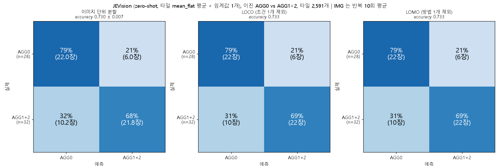

# JEVision 이진 평가 (AGG0 vs AGG1+AGG2), 설명문을 보강한 판 (jv07)

`../jev_binary_choice` (jv06) 와 **설계가 완전히 같고 설명문(`state`)만 보강한** 실험이다. 질문 문구, 선택지 순서 교차, 타일 2,591개, 임계값 선택과 평가 방식은 jv06 과 같다. 보강한 내용은 jv06 의 타일별 점수에서 평가 이미지의 타일을 직접 열어 본 오류 패턴에서 나왔다.

**주의: 설명문을 평가에 쓰는 같은 60장의 타일을 보고 고쳤기 때문에 이 실험의 점수는 낙관적일 수 있다.** 새 이미지에서 같은 향상이 나온다는 보장이 없다.

## 1. 한눈에 보기

| 평가 | jv06 (기준) | **jv07 (설명문 보강)** | 이미지 단위 95% CI (jv07) | DINOv2 이진 (참고) |
|---|---|---|---|---|
| 이미지 단위 분할 (IMG) | 0.648 | **0.730 ± 0.007** | [0.617, 0.833] | 0.898 |
| LOCO | 0.600 | **0.733** | [0.617, 0.833] | 0.850 |
| LOMO | 0.633 | **0.733** | [0.617, 0.833] | 0.833 |

- jv07 − jv06 (같은 이미지끼리 짝지은 이미지 단위 부트스트랩 95% CI): IMG +0.082 [-0.022, +0.182], LOCO **+0.133 [+0.017, +0.250]**, LOMO +0.100 [-0.017, +0.217]. LOCO 만 CI 가 0 을 제외한다.
- 라벨 순열 검사는 세 평가 모두 통과했다. 같은 온도 다수 라벨 규칙(0.667)과는 구분되지 않고, 처리 조건 암기(0.933)보다는 낮다.
- 이전 yes/no 형식(`noul`, 같은 타일 2,591개, 이 저장소에는 올리지 않음)의 0.680 / 0.683 / 0.700 과의 차이는 +0.050 [-0.038, +0.147], +0.050 [-0.050, +0.150], +0.033 [-0.067, +0.117] 로 CI 가 모두 0 을 포함한다.

## 2. 오류 패턴과 설명문 보강

jv06 의 타일별 점수(`p_flat`)에서 평가 이미지의 타일을 골라 확인용 시트(원본에서 잘라 2배 확대)로 만들어 직접 열어 봤다 (시트 이미지는 올리지 않았고 타일 목록은 `results/review_tiles.csv`).

| 그룹 | 본 것 | 패턴 |
|---|---|---|
| AGG0 이미지인데 점수 높음 | `p_flat` 상위 12개 (이미지당 최대 2개) | **전부 가장자리 타일** (마스크 비율 0.11~0.82): 시편 옆의 어둡고 매끈한 배경이 크게 들어옴 |
| 같은 그룹, 안쪽 타일만 | 상위 12개 (안쪽 타일 중) | 입상 질감은 그대로인데 조명의 밝은 띠와 호, 흠집과 섬유와 이물질, 노랗거나 갈색인 얼룩, 밝기 기울기와 반사 |
| AGG1+2 이미지인데 점수 낮음 | `p_flat` 하위 12개 (이미지당 최대 2개) | **전부 안쪽 타일이고 타일 전체에 입상 질감이 고름.** AGG 영역이 보이지 않음 |

세 번째 그룹은 모델의 오류가 아니라 타일 라벨이 이미지 라벨의 복사라서 생긴 것으로 보여 설명문을 고치는 근거로 쓰지 않았다. 앞의 두 그룹만 제외 항목으로 보강했다. AGG 정의 문장은 건드리지 않았다.

**추가한 설명문** (jv06 의 `state` 뒤에 이어 붙임):

> Only the sample surface can show AGG. Do NOT mark as AGG:
> - The dark, featureless background outside the sample, or the sample's edge where it meets the dark background (a crop may show part of the sample and part of the background).
> - Broad bright or dark bands, arcs, glare or brightness gradients caused by lighting, where the fine granular texture continues unchanged.
> - Scratches, fibers, dust or other small foreign marks on the surface.
> - Stains or color patches (for example yellowish or brownish) where the granular texture is still present.

질문 문구와 선택지 설명은 jv06 과 같다 (`flat`: "Does this crop contain a flat, smooth region that differs from the surrounding fine texture?", 선택지 `NO_FLAT_REGION` / `FLAT_REGION`).

## 3. 결과

| 평가 | `mean_flat` | `frac_flat` | balanced acc | recall AGG0 / AGG1+2 |
|---|---|---|---|---|
| IMG | 0.730 ± 0.007 | 0.593 | 0.733 | 0.79 / 0.68 |
| LOCO | 0.733 | 0.517 | 0.737 | 0.79 / 0.69 |
| LOMO | 0.733 | 0.400 | 0.737 | 0.79 / 0.69 |

혼동행렬 (primary, IMG 는 반복 10회 평균, LOCO/LOMO 는 60장 pooled): IMG AGG0 22.0 (79%) / 6.0 (21%), AGG1+2 10.2 (32%) / 21.8 (68%). LOCO 와 LOMO 는 AGG0 22 / 6, AGG1+2 10 / 22 로 같다 (임계값이 모든 fold 에서 거의 같은 값 0.473~0.480 이라서, 처리 조건이나 방법을 바꿔도 성능이 유지된다는 증거라기보다 임계값이 안정적이라는 뜻이다). jv06 은 AGG0 의 54% 만 맞혔으니 AGG0 쪽이 크게 나아졌다.

**기준선과의 비교** (이미지 단위): 학습 fold 다수 클래스 +0.196 [+0.017, +0.367], 같은 온도 다수 라벨 +0.062 [-0.110, +0.233], 처리 조건 암기 -0.203 [-0.333, -0.083].
**라벨 순열 검사** (20회): IMG 실제 0.730 vs 순열 최댓값 0.583, LOCO 0.733 vs 0.600, LOMO 0.733 vs 0.600. 세 평가 모두 초과.

**임계값 무관 AUROC** (AGG1+2 가 양성): `p_flat` 전체 타일 0.752 [0.621, 0.868] (jv06 0.707), 안쪽 타일만 0.811 [0.699, 0.913], `p_A` (NO 먼저) 0.570, `p_B` (FLAT 먼저) 0.786.

## 4. 관찰과 해석

관찰:
- **선택지 순서 편향은 jv06 보다 커졌다**: `FLAT_REGION` 을 고른 비율이 순서 A 10.1%, 순서 B 83.2%, 평균 확률 기준 44.3%. `|P_A - P_B|` 평균 0.605 (jv06 0.363), 두 순서의 선택이 다른 타일 73.1%.
- 직접 표시한 AGG 타일 17개의 이미지 안 percentile 평균 0.487 (무작위 0.5), 안쪽 타일 9개 0.253, 가장자리 타일 8개 0.750, 상위 25% 이내 4개 (무작위 기대 약 4.2개). jv06 (0.495 / 0.282 / 0.734) 과 거의 같다.

해석 (가능한 설명이며 확정이 아님):
- 어두운 배경과 가장자리 타일을 FP 로 보던 오류가 줄어든 것이 AGG0 정답률(54% → 79%)과 AUROC 상승(0.707 → 0.752)과 맞아떨어진다. 다만 이 보강은 평가 이미지를 보고 만든 것이라 일반화된 향상이라고 말할 수 없다.
- 이미지 단위 점수는 조금 올랐지만 표시한 AGG 타일의 위치를 가리키는 힘은 없다 (percentile 이 무작위 수준). 순서 편향은 설명문 보강으로 해결되지 않았다.
- 점수가 AGG 를 읽은 것인지 처리 조건의 외형을 읽은 것인지는 가를 수 없다 (처리 조건 암기 기준선 0.933).

## 5. 한계

- 위의 낙관성 (평가 이미지의 타일을 보고 프롬프트를 고침). 이 보강을 고르기 전에 다른 문구를 시도하지는 않았지만, 같은 60장으로 `noul` 형식의 프롬프트 세 개와 jv06 을 이미 평가한 뒤의 시도다.
- 라벨과 처리 조건의 얽힘, 이미지 60장의 넓은 CI, 타일 라벨이 이미지 라벨의 복사라는 점은 jv06 과 같다 (`../jev_binary_choice/README.md` 5절).
- 선택지 순서 편향이 커서 두 순서를 평균한 점수가 어느 한쪽 순서보다 낫다고 단정하기 어렵다 (`p_A` AUROC 0.570, `p_B` 0.786, 평균 0.752).

## 6. 스크립트와 실행

| 스크립트 | 하는 일 |
|---|---|
| `jv07_run_grid_tiles_choice_v2.py` | jv06 의 추론 스크립트(`../jev_binary_choice/jv06_run_grid_tiles_choice.py`)를 불러와 설명문만 바꿔 실행 (두 파일이 같은 위치에 있어야 한다) |
| `jv07_make_review_sheets.py` | jv06 의 타일별 점수에서 오류 확인용 시트와 `review_tiles.csv` 생성 (원본 사진 필요) |
| `config_jv07_choice_v2.yaml` | 평가 설정 (평가 스크립트는 `../jev_binary_choice/jv03_binary_agg0_vs_12.py`, 보조 분석은 `jv_tile_extras.py`) |

환경과 경로 제약은 `../jev_binary_choice/README.md` 6절과 같다: **저장소 안에서 그대로 실행되지 않는다** (원본 사진, DINOv2 의 분할 출력, 로컬 작업 폴더 경로가 필요).

## 7. 파일

- `results/tiles_grid_choice_v2.jsonl`: 타일별 응답 (2,591줄)
- `results/report.md`, `results/results_table.csv`, `results/confusion_counts.csv`, `results/fig_confusion_jevision_binary.png`: 평가 결과
- `results/extras.md`: 보조 분석, `results/review_tiles.csv`: 직접 열어 본 타일 목록 (확인용 시트 이미지는 올리지 않음)
