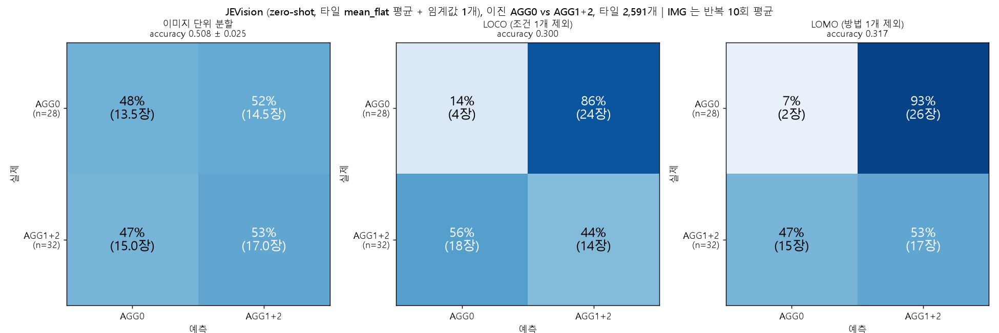

# JEVision 이진 평가 (AGG0 vs AGG1+AGG2), 예시 이미지를 함께 보낸 few-shot 판 (jv08)

`../jev_binary_choice` (jv06) 와 설계가 같고, **판단할 타일 앞에 예시 타일 이미지 3장(AGG 예시 2, 정상 예시 1)을 함께 보낸** 실험이다. 설명문 원문과 질문 문구, 타일 2,591개, 선택지 순서 교차, 임계값 선택과 평가는 jv06 과 같다. 결과는 **예시를 넣은 것이 오히려 점수를 크게 떨어뜨렸다**: 모델이 거의 모든 타일에 "AGG 없음"으로 답해서 점수가 변별력을 잃었다.

## 1. 한눈에 보기

| 평가 | jv06 (기준) | jv07 (설명문 보강) | **jv08 (예시 이미지)** | DINOv2 이진 (참고) |
|---|---|---|---|---|
| 이미지 단위 분할 (IMG) | 0.648 | 0.730 | **0.508 ± 0.025** [0.400, 0.613] | 0.898 |
| LOCO | 0.600 | 0.733 | **0.300** [0.183, 0.417] | 0.850 |
| LOMO | 0.633 | 0.733 | **0.317** [0.200, 0.433] | 0.833 |

- 이미지 단위 0.508 은 다수 클래스(0.533)와 구분되지 않는다 (-0.026 [-0.192, +0.137]). 라벨 순열 검사를 세 평가 모두 통과하지 못했다 (순열 최댓값 0.617 / 0.600 / 0.600).
- LOCO, LOMO 가 0.30 대인 것은 우연(0.5)보다 나쁜 값이다. 학습 fold 에서 고른 임계값이 거의 0 (0.008)이라 한쪽으로 몰아서 예측하기 때문이다 (LOMO 에서 AGG0 의 93% 를 AGG1+2 로 예측).
- 예시가 나온 이미지 3장을 평가에서 뺀 57장으로 다시 봐도 같다 (아래 4절).

## 2. 설정

- jv06 과 같은 것: 이미지 60장 (AGG0 28 / AGG1 14 / AGG2 18), 분석 타일 2,591개, `flat` 질문 문구와 선택지 설명, `extent` 질문, 선택지 순서 교차 (A: `NO_FLAT_REGION` 먼저, B: `FLAT_REGION` 먼저), 이미지 점수 (`mean_flat` primary, `frac_flat`), 임계값은 학습 fold 이미지에서만, 평가 (IMG 5-fold x 10, LOCO, LOMO, 부트스트랩, 순열 검사).
- **이미지 구성**: JEVision API 가 요청당 이미지를 최대 4장까지 받는다 (`api.py` 의 `MAX_IMAGES = 4`). 그래서 요청마다 [AGG 예시 1, AGG 예시 2, 정상 예시, 판단할 타일] 4장이다. 예시는 224px 를 256x256 으로 리사이즈한 PNG, 판단할 타일은 jv06 과 같이 224px.
- **설명문**: jv06 의 설명문 원문 뒤에 이미지의 순서를 알려 주는 한 문단만 추가했다 (이미지에는 이름이 없어서 필요하다): "Four images are attached, in this order: images 1 and 2 are example crops that contain AGG, image 3 is an example crop of a normal surface, and image 4 is the crop to judge. Answer only about image 4."
- **예시 선택** (결과를 보기 전에 정했고 AGG 예시는 JEVision 점수를 쓰지 않음):
  - AGG 예시: 직접 표시한 AGG 타일 17개(`../DINOv2_aggsim` 의 `c08`) 중 안쪽 타일(마스크 비율 100%)에서, 타일 경계 부근이라고 적은 2개를 뺀 7개 후보. 서로 다른 금속인 두 타일의 쌍 가운데 사진의 겉모습(평균 R, G, B 와 회색조 표준편차) 차이가 가장 큰 쌍. 결과는 `BASE/PH1230-1050 (#2, AGG1) r04_c03` (어두운 쪽)과 `REF/PH1180-1035 (#1, AGG1) r04_c03` (밝은 쪽).
  - 정상 예시: **AGG0 이미지**(이미지 전체에 AGG 가 없음)의 안쪽 타일 579개 중 두 AGG 예시의 겉모습 평균에 가장 가까운 타일 (정상 예시와 AGG 예시의 밝기 차이가 AGG 유무와 섞이지 않게 하려는 것). 결과는 `REF-LN/PH1255-1035 (AGG0) r04_c02`. 처음에는 AGG1 이미지의 `has_agg == 0` 타일에서 JEVision 점수가 가장 낮은 것을 고르려 했으나, 어두운 AGG 예시와 밝기가 같아 밝기 차이로 읽힐 수 있어 사용자가 AGG0 이미지에서 고르도록 바꿨다.
  - 선택한 3개의 위치는 `results/examples.json`.
- **누수 점검**: 예시가 평가 이미지 3장 (`BASE/PH1230-1050/x10#2`, `REF/PH1180-1035/x10#1`, `REF-LN/PH1255-1035/x10#!`)에서 나온다. 질의 타일이 예시 타일과 똑같은 경우가 3개 있다. 그래서 이 3장을 평가에서 뺀 57장 비교를 따로 했다.

## 3. 결과

| 평가 | `mean_flat` | `frac_flat` | balanced acc | recall AGG0 / AGG1+2 (`mean_flat`) |
|---|---|---|---|---|
| IMG | 0.508 ± 0.025 | 0.533 | 0.507 | 0.48 / 0.53 |
| LOCO | 0.300 | 0.533 | 0.290 | 0.14 / 0.44 |
| LOMO | 0.317 | 0.533 | 0.301 | 0.07 / 0.53 |

혼동행렬 (primary, IMG 는 반복 10회 평균, LOCO/LOMO 는 60장 pooled): IMG AGG0 13.5 (48%) / 14.5 (52%), AGG1+2 15.0 (47%) / 17.0 (53%). LOCO AGG0 4 / 24, AGG1+2 18 / 14. LOMO AGG0 2 / 26, AGG1+2 15 / 17.

**기준선과의 비교** (primary − 기준선, 이미지 단위 95% CI): IMG 다수 클래스 -0.026 [-0.192, +0.137], 같은 온도 다수 라벨 -0.160 [-0.327, +0.013], 처리 조건 암기 **-0.425 [-0.540, -0.305]**. LOCO 같은 온도 다수 라벨 -0.368 [-0.550, -0.183], LOMO -0.352 [-0.517, -0.167].
**임계값 무관 AUROC** (AGG1+2 가 양성): `p_flat` 전체 타일 0.565 [0.421, 0.713], 안쪽 타일만 0.492 [0.416, 0.567]. `frac_flat` 은 모든 이미지가 같은 값이라 0.500.

## 4. 예시가 나온 이미지 3장을 뺀 57장 비교

57장: AGG0 27 / AGG1+2 30 (다수 클래스 0.526). 임계값은 60장의 학습 fold 에서 고른 것을 그대로 쓰고 평가 이미지만 줄였다 (`results/subset_57_comparison.md`).

| 실행 | 57장 IMG | 57장 LOCO | 57장 LOMO | 57장 AUROC (AGG1+2 vs AGG0) |
|---|---|---|---|---|
| jv06 | 0.665 | 0.614 | 0.649 | 0.726 [0.580, 0.855] |
| jv07 | 0.754 | 0.754 | 0.754 | 0.774 [0.638, 0.890] |
| **jv08** | **0.496** | **0.281** | **0.298** | **0.550** [0.391, 0.705] |

jv08 − jv06: IMG -0.168 [-0.339, -0.000], LOCO -0.333 [-0.491, -0.158], LOMO -0.351 [-0.491, -0.211]. jv08 − jv07: -0.258 [-0.407, -0.116], -0.474 [-0.614, -0.333], -0.456 [-0.614, -0.298]. 57장에서도 예시를 넣은 판이 낮다는 결론은 같다.

## 5. 관찰과 해석

관찰:
- `FLAT_REGION` 을 고른 비율이 순서 A 0.0%, 순서 B 1.4%, 두 순서 평균 확률 기준 0.0%. 평균 `P(FLAT_REGION)` 은 0.013 으로 **거의 모든 타일에 "AGG 없음"으로 답했다**. 조건별 평균 `mean_flat` 은 0.004~0.032 에 몰려 있다.
- 선택지 순서 효과가 사라졌다 (`|P_A - P_B|` 평균 0.026). 편향이 풀린 것이 아니라 두 순서 모두 같은 답(NO)으로 포화된 것이다.
- 직접 표시한 AGG 타일 17개의 이미지 안 percentile 평균 0.442 (무작위 0.5), 안쪽 타일 9개 0.292, 가장자리 8개 0.612, 상위 25% 이내 3개 (무작위 기대 약 4.2개).

해석 (가능한 설명이며 확정이 아님):
- 예시 타일을 눈으로 보면 AGG 예시도 정상과 구분되지 않는다. 표시한 AGG 는 입상 질감이 고른 타일 안의 작은 어두운 반점이나 밝은 얼룩 정도다. 모델이 AGG 예시(1, 2번)를 정상 예시(3번)와 같은 질감으로 읽었다면 "질의 타일에 다른 영역이 있는가"에 거의 항상 아니라고 답했을 것이다. 가장 그럴듯한 설명이지만 모델 내부를 확인한 것은 아니다.
- 0.8B 모델이 이미지 여러 장을 놓고 예시와 비교해 판단하도록 학습되지 않았을 수 있다 (모델 카드의 학습 설명에서 그런 내용을 찾지 못했다). 이미지가 4장으로 늘어난 입력 자체가 한쪽 답으로 쏠리게 했을 가능성도 있다. 이 실험으로 이 가능성들을 가를 수 없다.

## 6. 한계

- 예시 3개만으로 한 번만 시도했다. 예시를 바꾸거나 여러 번 바꿔 평균하면 결과가 달라질 수 있다 (예시를 test 결과를 보고 바꾸면 선택이 평가에 맞춰지므로 하지 않았다).
- 표시한 AGG 타일은 한 사람의 판단이고 전문가 검증을 거치지 않았다. 표시하지 않은 타일에 AGG 가 없는지는 확인되지 않았다. 타일 라벨은 이미지 라벨의 복사다.
- 라벨과 처리 조건의 얽힘, 이미지 60장의 넓은 CI 는 jv06 과 같다 (`../jev_binary_choice/README.md` 5절).

## 7. 스크립트와 실행

| 스크립트 | 하는 일 |
|---|---|
| `jv08_select_examples.py` | 예시 타일 3개 선택과 확인 그림 (원본 사진 필요). 결과 `examples.json` |
| `jv08_run_grid_tiles_fewshot.py` | 예시 3장 + 판단할 타일 1장으로 추론 (`../jev_binary_choice/jv06_run_grid_tiles_choice.py` 를 불러와 쓴다, 두 파일이 같은 위치에 있어야 한다) |
| `jv08_subset_eval.py` | 예시가 나온 이미지 3장을 뺀 57장 비교 (jv06, jv07, jv08, 표준 라이브러리만 사용) |
| `config_jv08_fewshot.yaml` | 평가 설정 (평가 스크립트는 `../jev_binary_choice/jv03_binary_agg0_vs_12.py`) |

환경과 경로 제약은 `../jev_binary_choice/README.md` 6절과 같다: **저장소 안에서 그대로 실행되지 않는다** (원본 사진, DINOv2 의 분할 출력, 로컬 작업 폴더 경로가 필요).

## 8. 파일

- `results/tiles_grid_fewshot.jsonl`: 타일별 응답 (2,591줄)
- `results/report.md`, `results/results_table.csv`, `results/confusion_counts.csv`, `results/fig_confusion_jevision_binary.png`: 평가 결과
- `results/extras.md`: 보조 분석, `results/examples.json`: 예시 타일 위치, `results/subset_57_comparison.md`: 57장 비교 (예시 확인용 그림은 원본 사진을 잘라 만든 것이라 올리지 않음)
